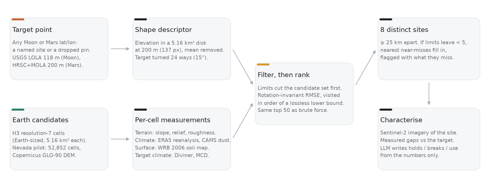
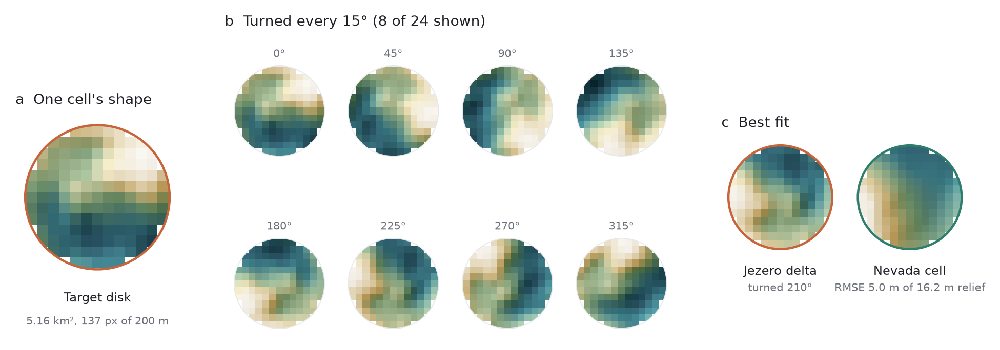
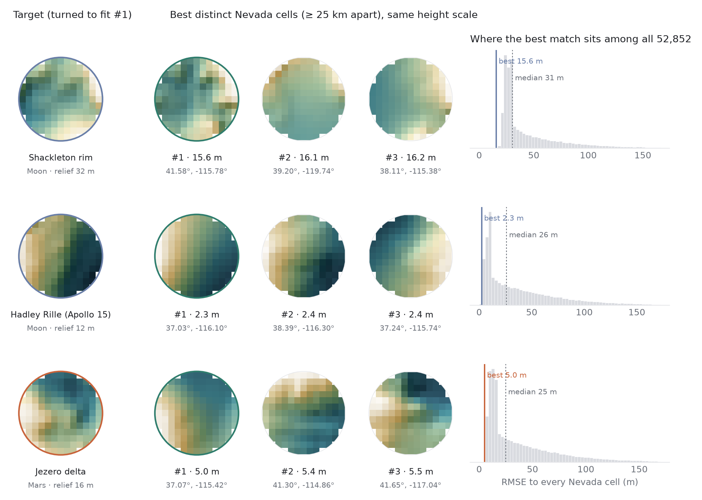
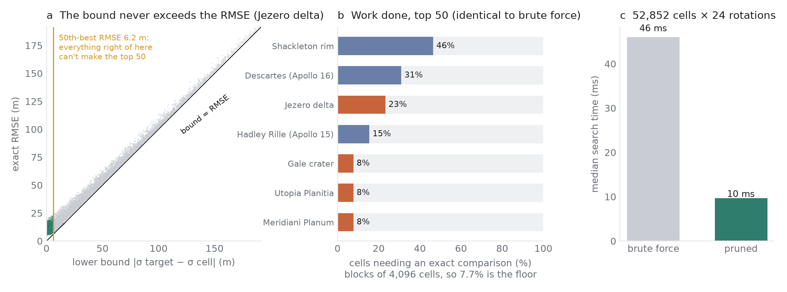
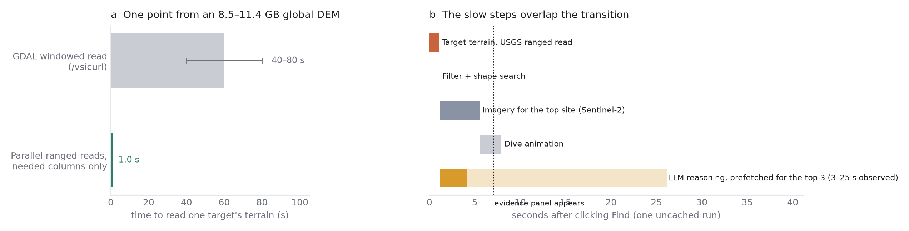
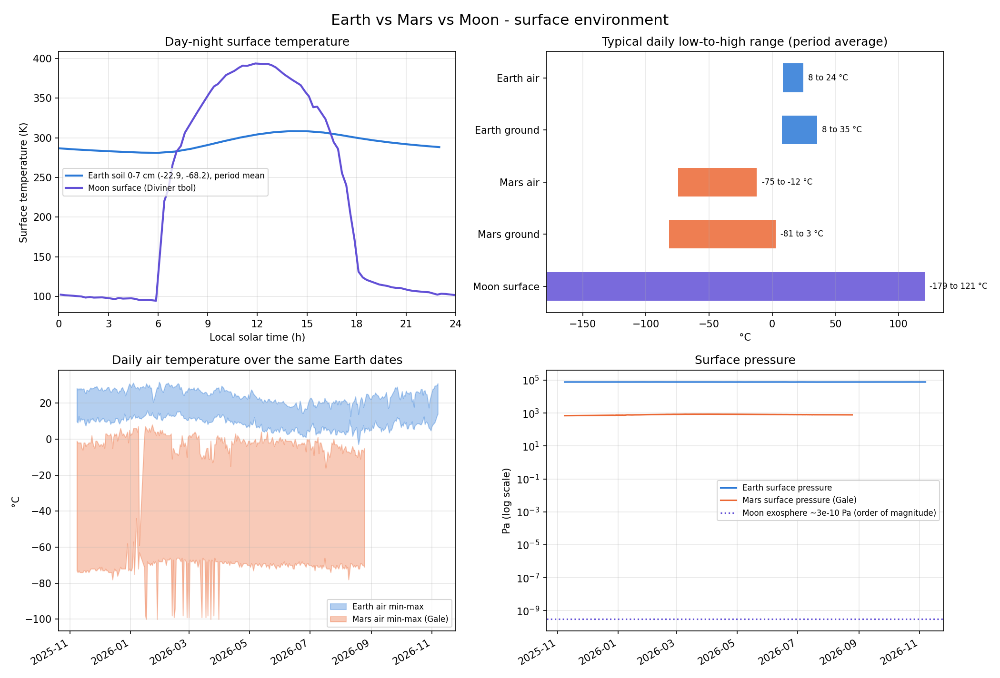
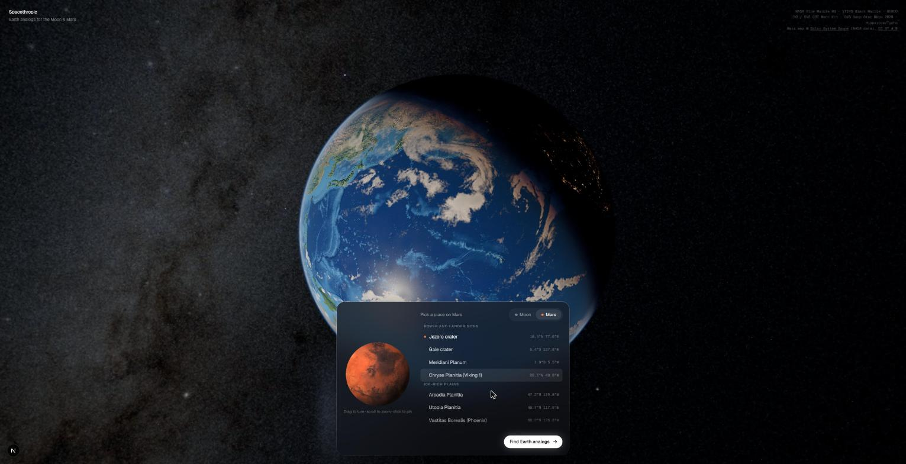

# Finding Earth analogs by the shape of the ground

**Method notes for the Spacethropic write-up.** These notes cover how the search works, why it is built this way, how it was validated, and where it falls short. Every figure is generated from the running code and data by `search/paper_figures.py`. The numbers quoted are in `figures/numbers.json`.

---

## 1. The question, made measurable

The challenge asks for Earth places that are useful analogs for Moon and Mars sites, and for an honest account of where each analogy holds and where it breaks. Two things follow from that:

1. **An analog is comparative, not absolute.** It is "like *this* place on Mars", so the search has to start from a specific target point and compare like with like.
2. **No single property makes an analog.** A site can match in terrain and fail in temperature. Each dimension has to be measured separately and reported separately, not folded into one opaque score.

The system takes any point on the Moon or Mars and searches Earth for ground with the **same shape at the same physical scale**. It then measures each candidate's climate and surface material against the target and says in plain terms what matches and what does not.

Terrain shape is the primary signal for three reasons. It is what landing, mobility and navigation tests depend on. It can be measured on all three bodies from global elevation models. And it varies at the kilometre scale, where the climate grids available to us are 10° or coarser.


*Figure 1. The search pipeline. The target is read live from global planetary elevation models. Earth candidates are fixed cells with precomputed measurements. Filtering happens before ranking, so a strict limit never empties the result list.*

---

## 2. A shape descriptor that means the same thing on every body

**Unit of comparison: an Earth-sized H3 resolution-7 cell.** Each candidate is an [H3](https://h3geo.org) hexagon of resolution 7 (average area 5.16 km²). A cell's shape is its elevation inside a disk of the same area (radius 1.28 km), sampled at 200 m. That gives 137 pixels.

- **The same physical disk is used on every body.** H3 cells on the Moon or Mars would have different areas. Here a Moon or Mars patch is always compared with an Earth patch of the same size in metres.
- **The mean height is removed, and tilt and relief are kept.** Absolute elevation means nothing across bodies, but a regional slope is a real property of the ground a rover would drive.
- **Matching ignores which way the terrain faces.** The target is resampled at 24 rotations (every 15°), and the best one is kept. A crater rim facing north on Mars is a valid analog for one facing east in Nevada.
- **Mirror images are not considered.** Only rotations are.

The distance is the **RMSE in metres** between the two mean-removed disks, minimised over rotation. Unlike an abstract similarity score, an RMSE is directly interpretable: "within 5 m RMS over a 5 km² area".


*Figure 2. (a) The Jezero delta target as a 137-pixel disk read from the HRSC+MOLA blended DEM. (b) The same disk resampled at 15° steps (8 of 24 shown). (c) At 210° it fits a Nevada cell to within 5.0 m RMS, against 16.2 m of relief in the target.*

### Elevation sources

| Body | Dataset | Native resolution | How it is read |
|---|---|---|---|
| Moon | LRO LOLA global LDEM (USGS Astrogeology mosaic) | 118 m | Live, per query |
| Mars | HRSC + MOLA blended global DEM v2 (USGS Astrogeology) | 200 m | Live, per query |
| Earth | Copernicus GLO-90 DSM | 90 m, smoothed to 200 m | Precomputed per cell |

---

## 3. Results on the Nevada pilot

The candidate set for this pilot is the whole of Nevada: **52,852 cells**. The method has no region-specific parameters. Section 8 covers scaling to the global land filter.


*Figure 3. Three targets, each against its three best Nevada cells (at least 25 km apart, same height scale). On the right, the RMSE of every Nevada cell, with the best match (solid) and the median (dashed).*

| Target | Target relief (σ) | Best RMSE | Nevada median RMSE | Score of best match |
|---|---:|---:|---:|---:|
| Hadley Rille (Apollo 15), Moon | 11.7 m | 2.3 m | 26.1 m | 96% |
| Jezero delta, Mars | 16.2 m | 5.0 m | 24.8 m | 91% |
| Shackleton rim, Moon | 32.2 m | 15.6 m | 30.6 m | 79% |

**The method separates strong matches from weak ones.** Hadley Rille's best Nevada match is about 11 times closer than a typical Nevada cell. Only 3.9% of Nevada comes within twice the best RMSE, so the match is specific.

Shackleton is the opposite case. Its best match is only twice as close as the median, and over half of Nevada comes within twice the best RMSE. Nevada has no ground shaped like a south-polar crater rim at this scale. The search reports that through a low score instead of forcing a confident answer.

---

## 4. Validation: does it find what it should?

The test needs ground truth, meaning a match that is known to be correct. Each query was a Nevada cell with a random rotation and 2 m of Gaussian noise added to its heights. The search then had to find the original cell among all 52,852.


*Figure 4. Recovery of 300 rotated, noisy Nevada cells, grouped by how much relief the cell has.*

- **85%** of queries return the original cell as #1, and **92%** have it in the top 10.
- For cells with more than 30 m of relief, **99%** rank #1.
- In **100%** of cases, the top result fits the query at least as well as the original cell. When the original is not #1, the method has not failed: in nearly flat cells (under 3 m of relief), many places are equally flat, and 2 m of noise is comparable to the signal. That ambiguity is physical and is reported as such.

---

## 5. Making it fast without losing matches

A query compares 137 pixels × 24 rotations against every candidate. Doing that naively for a planet-scale candidate set is too slow for an interactive tool. Two ideas make it fast while keeping the results exact.

### 5.1 A lossless lower bound

For mean-removed vectors, the reverse triangle inequality gives:

> RMSE(target, cell) ≥ | σ(target) − σ(cell) |

Here σ is the RMS height of each disk. Rotation leaves σ unchanged, apart from tiny resampling differences, which the code handles by bounding against the minimum and maximum σ over the 24 rotations. So every cell's σ is precomputed once.

At query time, cells are visited **in order of this bound**, the exact RMSE is computed in blocks, and the search **stops once the bound exceeds the current 50th-best exact RMSE**. Nothing past that point can enter the top 50.


*Figure 5. (a) For every Nevada cell, the bound against the exact RMSE for the Jezero target. The bound never exceeds the RMSE (0 violations in 52,852). (b) The share of cells that needed an exact comparison, by target. (c) Median search time over the seven targets.*

- **The results are identical to brute force for all seven test targets**, checked in code.
- Only **8–46%** of cells need an exact comparison, depending on the target. Targets whose relief is unusual for Nevada prune the most.
- The median search time falls from **48 ms to 10 ms**.
- The exact step is one matrix product, run in float64. An earlier float32 version gave slightly different rankings from brute force, because a small RMSE is the difference of two large sums.

### 5.2 Reading one point from a 10 GB planet

The Moon and Mars elevation mosaics are single global GeoTIFFs of **8.5 GB and 11.4 GB**. A standard windowed read over HTTP (GDAL `/vsicurl`) took **40–80 s** per target in our tests, which is unusable interactively.

Both mosaics are uncompressed, with each image row stored back to back. The byte offset of any pixel can therefore be computed directly. The search fetches only the needed columns of the roughly 40–60 needed rows as parallel HTTP range requests, from a few hundred bytes to a few kilobytes each depending on latitude.


*Figure 6. (a) Reading one target's terrain: about 1 s with ranged reads (0.9–4.0 s across the seven test targets) against 40–80 s with the GDAL windowed read. (b) One uncached query end to end. Imagery and the written analysis are fetched while the transition plays, so the slow steps overlap it.*

As a result, **any** point on either body can be a target, not just a precomputed list of sites, and nothing planetary has to be stored.

---

## 6. Beyond shape: what each candidate carries

Shape only says the ground is shaped alike. Each Earth cell also carries measurements in the same units as the target where possible, so the differences can be stated in numbers.


*Figure 7. Some of the per-cell layers over Nevada: two terrain measures from the elevation model, the climate grid, and surface material from the soil map.*

| Dimension | Earth source | Moon / Mars source |
|---|---|---|
| Slope, steepest 10% slope, flat ground (< 5°), relief, height range, roughness, bowl vs dome | Copernicus GLO-90, per cell | Same disk, from the LOLA or HRSC-MOLA DEM |
| Surface temperature (mean, coldest, hottest, day–night swing), air temperature range, pressure, wind, humidity, cloud | ERA5 reanalysis via Open-Meteo, a 10° grid interpolated | Moon: LRO Diviner. Mars: Mars Climate Database (LMD) |
| Dust | CAMS aerosol optical depth and near-surface dust | Mars: MCD dust optical depth |
| Surface material | WRB 2006 world soil map, 0.02° (most common group per cell) | Not measured |

**The surface material is a soil map, not geology.** Each WRB soil group is shown with a plain label (Calcisols as "Carbonate", Gypsisols as "Gypsum", Cryosols as "Permafrost", and so on). Each label's description gives the WRB definition, and a link to lunar or Martian materials is offered only as a possible resemblance. Calcisols, for example, carry secondary carbonate. Mars has carbonates too, as at Jezero, but they formed differently.


*Figure 8. From the earlier climate study: the surface environments of Earth, Mars and the Moon on one set of axes. It shows the gap no Earth site can close. The Moon's surface swings about 300 °C between day and night, Martian air is 0.7 kPa against Earth's 100 kPa, and the Moon has effectively no atmosphere.*

That earlier study ranked Earth places by temperature profile alone (`db/mirror.py`). Two things moved the primary signal to terrain shape. The climate grids are too coarse to tell neighbouring sites apart. And no Earth surface is as cold as the lunar poles, so temperature on its own separates poorly. Temperature is now a measured gap to report rather than the thing being ranked on.

---

## 7. From numbers to a decision

### 7.1 Score and limits

The match score is shown to users as a percentage:

> score = exp(−(RMSE / σ_target)²)

It is relative to the target's own relief. Matching a flat plain to within 5 m is unremarkable, while matching a 30 m-relief rim to within 5 m is very close. A researcher's "match ≥ X%" limit is converted to an RMSE cap for that query, so it filters the real search.


*Figure 9. (a) The score curve and how a limit becomes an RMSE cap. (b) The score of every Nevada cell against Jezero. Only 1 cell reaches 90%, and 13,753 reach 50%.*

### 7.2 Filters first, then near misses

Limits on any measured field (slope, temperature, dust, surface material and so on) cut the candidate set **before** ranking. Results are kept **at least 25 km apart**, so the list shows distinct places rather than neighbouring cells of one valley.

If the limits leave fewer than 5 sites, the closest **near misses** fill the remaining places. Each is ranked by how far it falls outside the limits, measured against each field's range, plus a small weight on shape, and each is labelled with the limits it misses. A strict search therefore never returns an empty page, and it never hides that a compromise was made.

### 7.3 Written characterisation

For each site, a language model (Gemini 3.5 Flash) writes:
- a one-line verdict;
- three ways the analogy holds and three ways it breaks, each a short claim with its figures;
- one exploration activity worth rehearsing at the site.

It is constrained to be checkable:

- It receives **only the measured values**: the shape statistics, the per-field values for the site and the target, and the soil group with its definition. It does not get the site's name or imagery, so it cannot draw on recalled facts about a famous place.
- It must cite figures for every point, and it is told that the soil map is not mineralogy.
- At most one "breaks" point may cover what no Earth site can reproduce: gravity, vacuum or thin CO₂ air, radiation.
- If the model is unavailable, the panel falls back to rule-based text built from the same measured gaps.


*Figure 10. Choosing a target. Any point can be dropped on the rotating body. Named sites are a shortcut, not a limit.*


*Figure 11. A result. Sentinel-2 imagery of the Nevada cell with the matched disk outlined. The evidence panel shows the two relief disks side by side, the written verdict, where the analogy holds and breaks with figures, and a suggested activity to rehearse there.*

---

## 8. Limitations

- **Pilot region.** The candidate set is Nevada, 52,852 cells. The global step is the team's eligible-land mask: H3 r7 cells with no open water, dense vegetation or human footprint. Search cost grows linearly with the number of cells and is cut by the bound in section 5.1. The descriptor and code do not change.
- **Scale.** At 200 m pixels in a 2.6 km disk, the descriptor sees landforms from about 400 m to about 2.5 km. It is blind to boulders, small craters and narrow rilles, and to features larger than a cell.
- **Elevation quality.** HRSC+MOLA falls back to roughly 460 m MOLA data where HRSC coverage is missing. Polar LOLA data are well sampled, but equatorial data between tracks is interpolated. Copernicus GLO-90 is a surface model (it includes vegetation and buildings), which matters little in Nevada but will matter elsewhere.
- **Climate resolution.** Earth climate comes from a 10° grid interpolated to each cell. It is useful as a regional contrast with the target, but it cannot tell neighbouring sites apart.
- **Material.** WRB groups describe soil formation, not rock type or mineralogy. Mapping them to planetary materials is an interpretation, and the system labels it as one.
- **Flat terrain is ambiguous.** For targets with under about 3 m of relief, many places match equally well (section 4). The ranking among them is not meaningful.
- **What Earth cannot reproduce.** Gravity, vacuum or 0.7 kPa CO₂ air, radiation and lunar temperature extremes are outside any terrestrial analog. They are reported as gaps, not scored.
- **The written analysis depends on an external API.** Latency ranged from 3 to 25 s, and the free tier returned rate-limit errors under load. The measured values and the fallback text do not depend on it.

---

## 9. Reproducing

```bash
cd search
py -3.12 -m venv .venv && .venv/Scripts/python -m pip install -r requirements.txt
.venv/Scripts/python prepare.py            # Copernicus tiles in dem/ -> out/nevada_patches.npz
.venv/Scripts/python soil.py <wrb csv>     # -> out/wrb_0.02deg.npz
.venv/Scripts/python test_nevada.py        # recovery and brute-force equality checks
.venv/Scripts/python paper_figures.py      # every figure and number in this document
.venv/Scripts/python -m uvicorn api:app --port 8787
```

The core method is in `search/shape.py` (about 130 lines). Search, filters and per-cell measurements are in `search/api.py`. The language-model prompt and output schema are in `search/compare.py`.

### Data and licences

| Data | Provider | Licence |
|---|---|---|
| LRO LOLA LDEM 118 m; HRSC+MOLA blended DEM 200 m | NASA / ESA / DLR, mosaics by USGS Astrogeology | Public domain / ESA terms |
| Copernicus GLO-90 DSM | ESA / Copernicus | Copernicus licence (free use) |
| Sentinel-2 cloudless 2016 | EOX IT Services | CC BY 4.0 |
| ERA5 reanalysis, CAMS aerosols (via Open-Meteo) | ECMWF / Copernicus | CC BY 4.0 |
| LRO Diviner surface temperature | NASA PDS | Public domain |
| Mars Climate Database | LMD / ESA / CNES | Free for research |
| WRB 2006 world soil map | FAO / IUSS | Free use with attribution |
| H3 hexagonal grid | Uber (open source) | Apache 2.0 |
| GeoNames place names | GeoNames | CC BY 4.0 |
