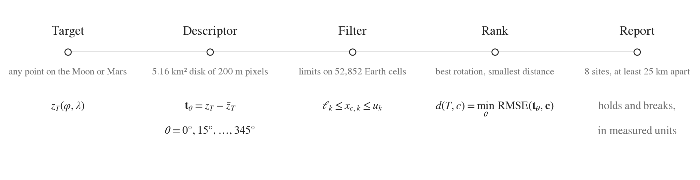
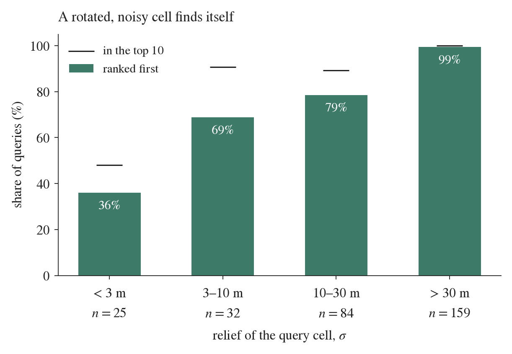
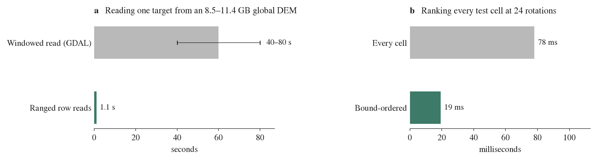
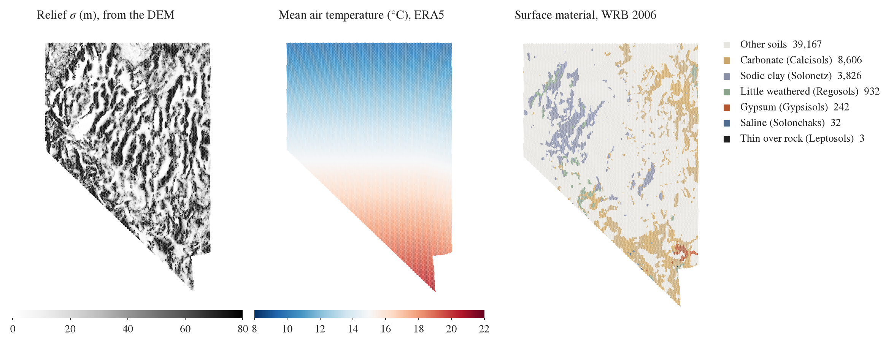
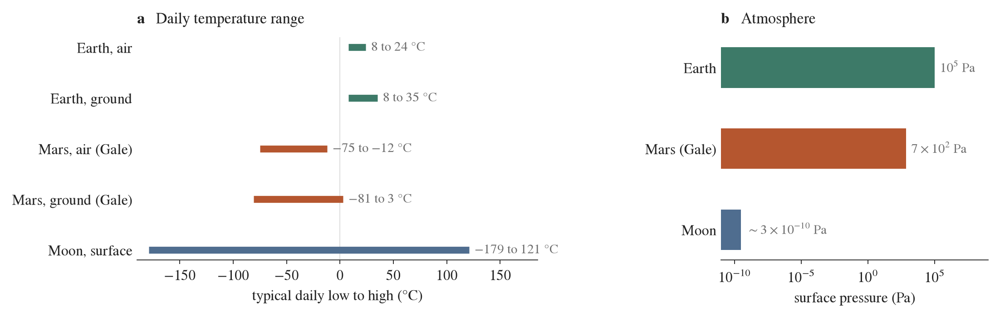
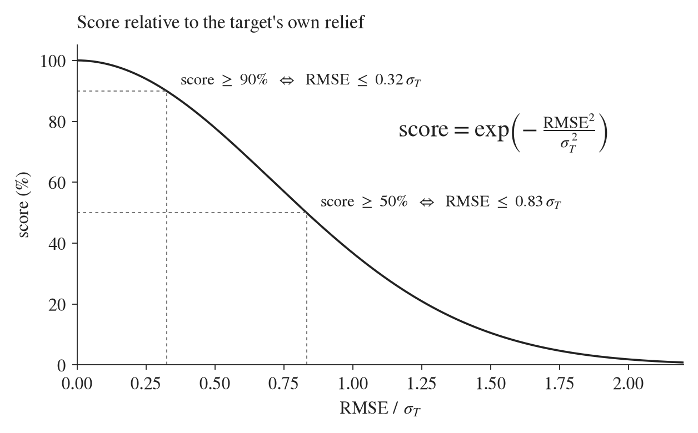
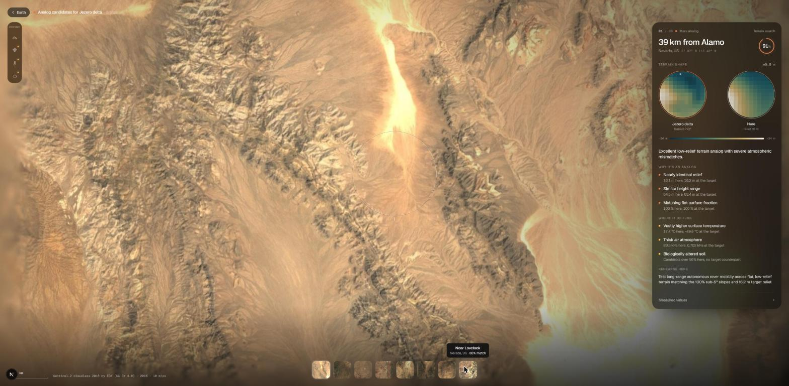

# Finding Earth analogs by the shape of the ground

*Method notes for the Spacethropic submission (NASA Space Apps 2026). Every figure and number is produced from the working system by `search/paper_figures.py`; the raw values are in `figures/numbers.json`.*

---

## In one paragraph

Given any point on the Moon or Mars, the system finds places on Earth where the ground has the same shape at the same physical scale, then measures how each place compares in climate and surface material. Shape is compared over a 5.16 km² disk, as the root-mean-square height difference after rotating the target to fit. The search is exact, costs about 0.2 µs per Earth cell, and reads the planetary terrain live from 8–11 GB global elevation models in about one second. Each result states where the analogy holds and where it breaks, in measured units.

*Numbers quoted below are measured on a test region of 52,852 cells (Nevada). Nothing in the method is specific to it.*


*Figure 1. The method in five steps. A target point becomes a set of rotated height patterns; Earth cells that pass the user's limits are ranked by their distance to the closest rotation; the best distinct sites are reported with their measured differences.*

---

## 1. Why terrain shape

The challenge asks for analogs that are useful for exploration and honest about their limits. That favours a property that:

- **matters for operations:** landing, driving, navigation and construction all depend on slopes and relief;
- **can be measured on all three bodies:** global elevation models exist for the Moon, Mars and Earth;
- **varies at the scale of a site:** climate data for this project comes on a 10° grid, far too coarse to tell neighbouring places apart.

Terrain shape meets all three. Climate and material are measured too, but they are reported as similarities and gaps rather than used to rank.

---

## 2. Describing a place by its shape

**Takeaway: each place becomes 137 heights, compared at every rotation.**

Each Earth candidate is an H3 hexagon at resolution 7 (average area 5.16 km²). Its shape is the elevation inside a disk of the same area, sampled every 200 m, with the average height subtracted. A Moon or Mars target is read the same way, so both sides always cover the same ground in metres.

The distance between a target *T* and an Earth cell *c* is

> d(T, c) = min over θ of RMSE(t<sub>θ</sub>, c),  with θ = 0°, 15°, …, 345°

that is, the target is turned in 15° steps and the best fit is kept. The result is in metres and is easy to read: "the two surfaces differ by 5 m on average over the disk".


*Figure 2. (a) The Jezero delta target, from the HRSC + MOLA elevation model. (b) The same disk at several rotations. (c) The closest Earth cell fits the target turned 210° to within 5.0 m, against 16.2 m of relief in the target itself.*

Design choices, briefly:
- **Same physical size on every body.** Using Earth-sized cells everywhere keeps the comparison in real metres.
- **Height offset removed, slope kept.** Absolute elevation means nothing across planets; a regional tilt is real ground a rover would drive.
- **Rotations, not reflections.** Terrain that faces a different way is still the same terrain.

---

## 3. What it finds

**Takeaway: strong matches stand out clearly, and weak ones are reported as weak.**

Measured on the test region of 52,852 cells.


*Figure 3. Three targets and their three closest Earth cells, at least 25 km apart and drawn on the same height scale. Below each Earth cell: its RMSE and its score.*

| Target | Target relief σ | Best match | Typical cell | Score |
|---|---:|---:|---:|---:|
| Hadley Rille, Moon | 11.7 m | 2.3 m | 26.1 m | 96% |
| Jezero delta, Mars | 16.2 m | 5.0 m | 24.8 m | 91% |
| Shackleton rim, Moon | 32.2 m | 15.6 m | 30.6 m | 79% |

- **Hadley Rille** has a highly specific match: the best cell is eleven times closer than a typical one, and fewer than 4% of cells come within twice that distance.
- **Shackleton** does not. The best cell is only twice as close as a typical one. The test region has no ground shaped like a south-polar crater rim at this scale, and the lower score says so.

---

## 4. Does it find the right answer?

**Takeaway: given a place it should find, it finds it 85% of the time, and 99% of the time when the ground has real relief.**

To test this we need a case where the correct answer is known. We took 300 random cells from the test region, turned each by a random angle, added 2 m of random height noise, and searched for them among all of its cells.


*Figure 4. How often the original cell comes back first (bars) or in the top 10 (marks), by how much relief the cell has.*

When the original is not ranked first, the cell above it always fits at least as well (300 of 300 cases). The misses are almost all in near-flat ground, where many places are equally flat and 2 m of noise is as large as the signal. That is an honest ambiguity in the data, not an error in the search.

---

## 5. Making it fast, without approximations

**Takeaway: a simple inequality lets the search skip most of the work and still return exactly the same answer.**

Comparing 137 heights at 24 rotations against every cell is wasteful. Two quantities help: the relief of the target, σ<sub>T</sub>, and the relief of each cell, σ<sub>c</sub>, both computed in advance. For patterns with their average removed, the triangle inequality gives

> RMSE(T, c) ≥ | σ<sub>T</sub> − σ<sub>c</sub> |

A cell whose relief is very different from the target's cannot be a close match. The search therefore visits cells in order of this lower bound and stops as soon as the bound exceeds the 50th-best distance found so far.


*Figure 5. (a) For every test cell, the bound never exceeds the true distance (no exceptions among 52,852). Only cells left of the dashed line (green) need to be compared. (b) The share of cells compared exactly, for seven targets. The search works in blocks of 4,096 cells, so 8% is the minimum.*

The results are identical to comparing every cell, for all seven targets. Cost grows linearly with the number of cells: about 0.9 µs per cell when every cell is compared, and 0.2 µs with the bound. The comparison itself is a single matrix product in double precision; single precision was tried and gave slightly different rankings, because small distances come from subtracting large sums.

### Reading the Moon and Mars on demand

The global elevation models are single files of 8.5 GB (Moon) and 11.4 GB (Mars). A standard windowed read over the web took 40 to 80 seconds per target. Because both files store each image row uncompressed, one after another, the position of any pixel in the file can be calculated directly. The system downloads only the 40–60 short row segments it needs, in parallel.


*Figure 6. (a) Reading one target's terrain. (b) Ranking every test cell at every rotation, with and without the bound.*

As a result, **any** point on either body can be searched, not only a prepared list, and no planetary data has to be stored.

---

## 6. Beyond shape: climate and material

**Takeaway: each candidate also carries measurements that can be compared with the target's directly.**


*Figure 7. Three of the per-cell measurements, across the test region.*

| Dimension | Earth | Moon and Mars |
|---|---|---|
| Terrain: slope, steepest slope, flat ground, relief, height range, roughness, bowl or dome | Copernicus GLO-90, per cell | Same disk, from LOLA (Moon) or HRSC + MOLA (Mars) |
| Temperature, day–night swing, pressure, wind, humidity, cloud | ERA5 reanalysis (10° grid, interpolated) | LRO Diviner (Moon), Mars Climate Database (Mars) |
| Dust | CAMS aerosols | Mars Climate Database dust optical depth |
| Surface material | WRB 2006 world soil map, 0.02° | Not measured |

**The surface layer is a soil map, not a geology map.** Each soil group is labelled with what it is (Calcisols: "Carbonate"; Gypsisols: "Gypsum"; Cryosols: "Permafrost"). Any link to lunar or Martian materials is presented as a possible resemblance, not a match. Calcisols contain carbonate, as Jezero does, but formed in a different way.

These measurements make the limits of any Earth analog explicit:


*Figure 8. From the team's earlier three-body climate study. (a) The lunar surface swings about 300 °C between day and night; nowhere on Earth comes close. (b) Martian air is about 1% of Earth's pressure; the Moon has effectively none.*

That earlier study ranked Earth places by temperature alone. It showed why temperature is a poor primary signal: the grids are too coarse to separate nearby sites, and no Earth surface is as cold as the lunar poles. Temperature became a measured gap to report rather than the thing to rank on.

---

## 7. From measurements to a recommendation

### A score relative to the target

The match is shown as a percentage, scaled by the target's own relief:

> score = exp( −RMSE² / σ<sub>T</sub>² )

Matching a flat plain to within 5 m is unremarkable; matching a 30 m rim to within 5 m is close. When a user asks for "match ≥ 90%", the limit becomes a cap on RMSE for that particular target, and the search applies it directly.


*Figure 9. The score as a function of RMSE, and the RMSE cap each limit implies. Against Jezero, only 1 test cell reaches 90% and 13,753 reach 50%.*

### Filters first, then near misses

Limits on any measurement (slope, temperature, material and so on) remove cells **before** ranking. Results are kept **at least 25 km apart**, so the list shows different places rather than neighbouring cells of one valley. If the limits leave fewer than five sites, the closest near misses fill the list, each marked with the limits it misses. A strict search never returns an empty page, and it never hides a compromise.

### A written comparison, grounded in the numbers

For each site a language model (Gemini 3.5 Flash) writes a one-line verdict, three ways the analogy holds, three ways it breaks, and one activity worth rehearsing there. It is constrained so that every statement can be checked:

- it receives **only the measured values**, never the site's name or imagery, so it cannot draw on what it may recall about a famous place;
- every point must cite figures;
- it is told the soil map is not mineralogy;
- at most one point may concern what Earth cannot reproduce: gravity, vacuum or thin CO₂ air, radiation.

If the model is unavailable, the panel falls back to rule-based text built from the same measured differences.


*Figure 10. Choosing a target: a named site or any point dropped on the globe.*


*Figure 11. A result: Sentinel-2 imagery of the site with the matched disk outlined; the two terrain disks side by side; the verdict, with where the analogy holds and breaks.*

---

## 8. Limitations

- **One scale.** With 200 m pixels over a 2.6 km disk, the method sees landforms from roughly 400 m to 2.5 km. It misses boulders, small craters and narrow channels, and anything larger than a cell.
- **Elevation quality varies.** Where HRSC coverage is missing, the Mars model falls back to MOLA at about 460 m. Copernicus GLO-90 is a surface model that includes vegetation and buildings; this matters little on bare arid ground, more where there is vegetation.
- **Coarse climate.** Earth climate is a 10° grid. It contrasts a region with the target well but cannot separate neighbouring sites.
- **Soil, not rock.** WRB groups describe soil formation. Linking them to planetary materials is an interpretation and is labelled as one.
- **Flat ground is ambiguous.** Below about 3 m of relief, many places match equally well (section 4).
- **What Earth cannot provide.** Gravity, vacuum or thin CO₂ air, radiation and lunar temperature extremes are reported as gaps, not scored.
- **The written comparison depends on an external service.** Its response time ranged from 3 to 25 seconds, and the free tier hit rate limits under load. The measurements and the fallback text do not depend on it.

---

## Reproducing

```bash
cd search
py -3.12 -m venv .venv && .venv/Scripts/python -m pip install -r requirements.txt
.venv/Scripts/python prepare.py               # Copernicus tiles -> out/nevada_patches.npz
.venv/Scripts/python soil.py <wrb csv>        # -> out/wrb_0.02deg.npz
.venv/Scripts/python test_nevada.py           # recovery and brute-force checks
.venv/Scripts/python -X utf8 paper_figures.py # every figure and number here
.venv/Scripts/python -m uvicorn api:app --port 8787
```

The method is in `search/shape.py` (about 130 lines); search, limits and measurements in `search/api.py`; the language-model instructions in `search/compare.py`.

### Data

| Data | Source | Licence |
|---|---|---|
| LRO LOLA 118 m and HRSC + MOLA 200 m global elevation | NASA, ESA, DLR; mosaics by USGS Astrogeology | Public domain / ESA terms |
| Copernicus GLO-90 elevation | ESA / Copernicus | Free use (Copernicus licence) |
| Sentinel-2 cloudless 2016 imagery | EOX IT Services | CC BY 4.0 |
| ERA5 reanalysis and CAMS aerosols, via Open-Meteo | ECMWF / Copernicus | CC BY 4.0 |
| LRO Diviner surface temperature | NASA Planetary Data System | Public domain |
| Mars Climate Database | LMD, ESA, CNES | Free for research |
| WRB 2006 world soil map | FAO / IUSS | Free use with attribution |
| H3 hexagonal grid | Uber, open source | Apache 2.0 |
| Place names | GeoNames | CC BY 4.0 |
