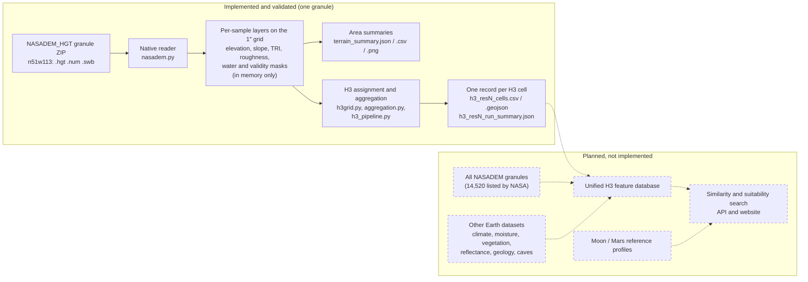
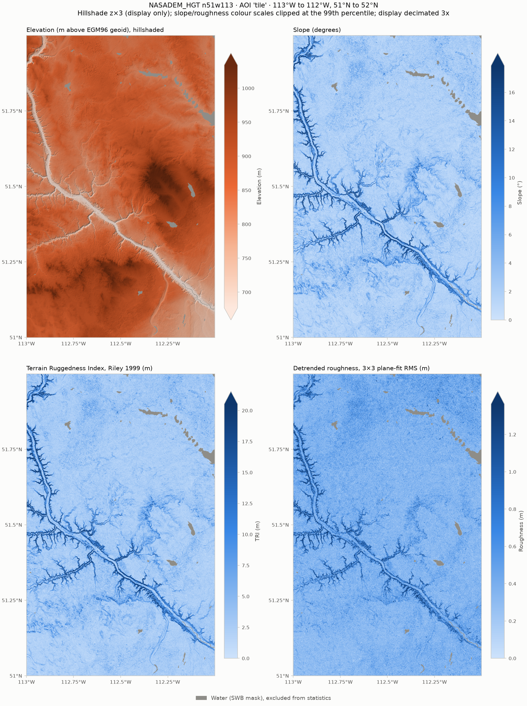
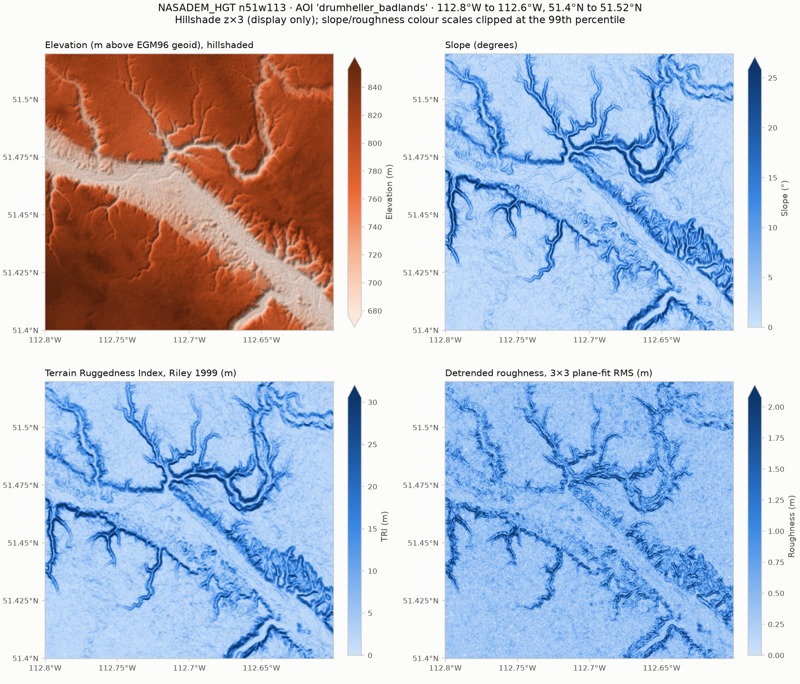
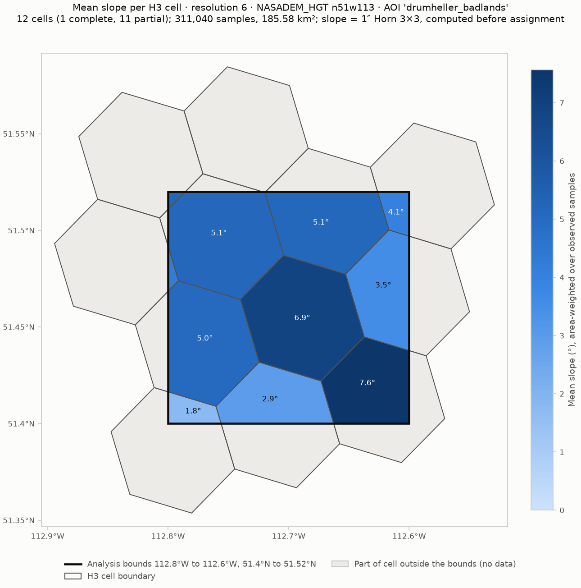
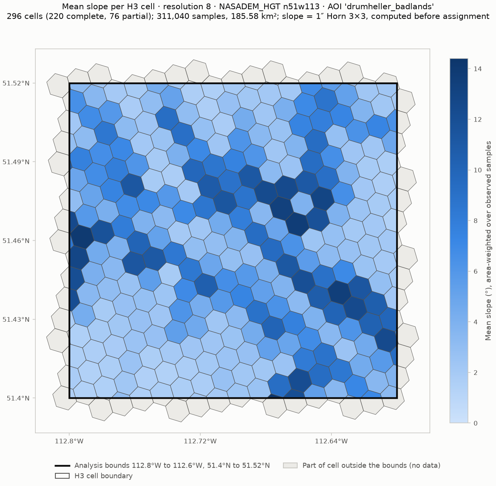
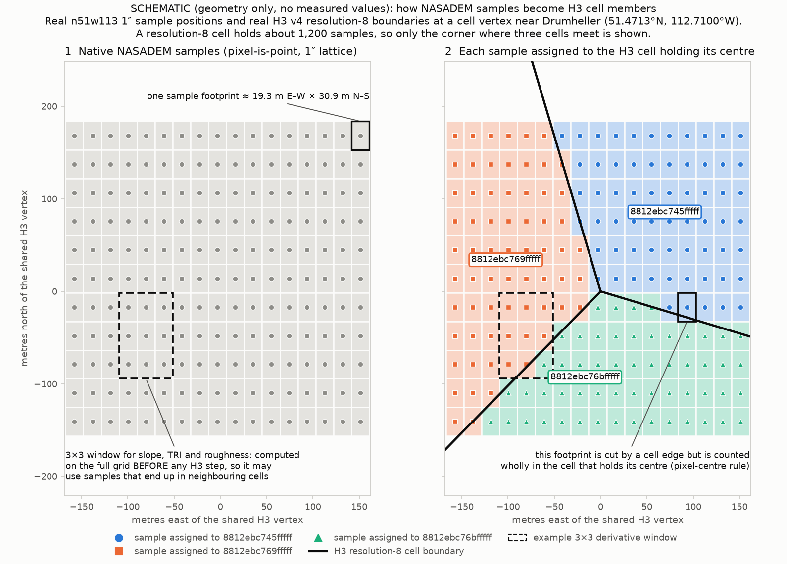

# Spacethropic: NASADEM terrain and H3 pilot, technical handoff

| | |
|---|---|
| **Status** | Pilot complete and validated for **one** NASADEM granule (`n51w113`) and **one** study area (Drumheller badlands, Alberta, Canada) |
| **Pilot tickets** | SPACETHROPIC-01 (ingestion and terrain analysis) · DRUMHELLER-PILOT-02 (independent validation) · DRUMHELLER-PILOT-03 (H3 aggregation) |
| **Code** | `spacethropic` 0.1.0 in `src/spacethropic/` · Python 3.12.10 · numpy 2.5.4 · matplotlib 3.11.2 · h3-py 4.5.0 (H3 C library 4.5.0) · tested on Windows 11 |
| **Written** | 2026-11-14 |
| **Audience** | The developer taking over the unified geographic feature database, and anyone joining the project |

**Evidence labels.** Where the distinction matters, statements carry one of these labels:

| Label | Meaning |
|---|---|
| **Verified** | Checked against files in this repository (stored outputs, validation results), or reproduced by a test run on 2026-11-14 while writing this handoff |
| **Choice** | An implementation decision. It is reasonable, but other choices were possible |
| **Planned** | A future step or a recommendation. **Not implemented** |
| **Limitation** | A known weakness that is still open |
| **External** | Taken from NASA documentation, not checked against local files |

Values in this document are quoted from the stored outputs. Where a value is rounded here, the file holds the full precision (12 significant digits).

## Contents

- [Executive overview](#executive-overview)
- [1. Research purpose and current scope](#1-research-purpose-and-current-scope)
- [2. The original NASADEM dataset](#2-the-original-nasadem-dataset)
- [3. Processing methodology](#3-processing-methodology)
- [4. Independent scientific validation](#4-independent-scientific-validation)
- [5. H3 aggregation](#5-h3-aggregation)
- [6. Figures and interpretation](#6-figures-and-interpretation)
- [7. Files and numerical outputs](#7-files-and-numerical-outputs)
- [8. Data contract for the database developer](#8-data-contract-for-the-database-developer)
- [9. Reproduction instructions](#9-reproduction-instructions)
- [10. Limitations and future scaling work](#10-limitations-and-future-scaling-work)
- [Appendix A. Glossary](#appendix-a-glossary)
- [Appendix B. Evidence register](#appendix-b-evidence-register)

---

## Executive overview

- **What exists.**
  - A small Python package reads a NASADEM_HGT elevation granule directly from its ZIP file.
  - It measures four terrain properties at every 1-arc-second sample: elevation, slope, Terrain Ruggedness Index (TRI) and detrended roughness.
  - It summarises them over an area, and also aggregates them into **H3 hexagon cells**.
  - Results are written as JSON, CSV, GeoJSON and PNG.
- **What was tested.** One granule, `n51w113` (51–52°N, 113–112°W), and a 185.58 km² box around the Drumheller badlands. **Verified:**
  - An independently written reference implementation reproduced every pixel and all 88 summary statistics (40 of 40 checks passed).
  - The H3 cell results reconcile exactly with the area summary: 22 of 22 checks pass for each resolution and reference.
  - The automated test suite gives **80 passed, 1 skipped**. The skipped test is the optional GDAL/rasterio cross-check.
- **Main scientific result.** The Drumheller badlands are measurably more rugged than the 1°×1° tile around them:
  - mean slope 5.26° vs 2.92°;
  - 95th-percentile slope 18.21° vs 7.78°;
  - mean TRI 6.47 m vs 3.81 m.
- **H3 output (Verified).**
  - Resolution 6, the proposed global baseline: **12 cells** (1 complete, 11 partial).
  - Resolution 8, a local-detail demonstration: **296 cells** (220 complete, 76 partial).
  - Every cell record carries its H3 id, coverage, sample counts, terrain statistics, quality flags and provenance.
- **What does not exist yet.** None of the following has been built ([§10](#10-limitations-and-future-scaling-work)):
  - global or multi-granule processing, and cross-tile derivatives;
  - streaming aggregation;
  - a land mask, and a verified count of about 4.09 million land cells;
  - any database, API, search or website;
  - other datasets;
  - Moon/Mars reference data and similarity ranking.
- **Where the database developer should start.** Use the H3 CSV files and their run summaries ([§7](#7-files-and-numerical-outputs), [§8](#8-data-contract-for-the-database-developer)).
  - The H3 cell id is the join key.
  - These files total about 0.6 MB and are enough to design and test the import.
  - The raw NASADEM ZIP is not needed for that work.

### Architecture



*Schematic, not data.* Solid boxes and arrows are implemented and validated for one granule. Dashed boxes and arrows are planned.

---

## 1. Research purpose and current scope

### 1.1 What Spacethropic is for

Spacethropic is a NASA Space Apps Challenge 2026 project. Its goal is to discover and rank places on Earth whose environment resembles a particular Moon or Mars location, or a mission scenario.

- **Search space.** The plan is to search land cells of the H3 global grid at resolution 6.
  - H3 resolution 6 has **14,117,882** cells worldwide, *including oceans*. The average hexagon is 36.13 km², with edges of 3.72 km. **Verified**: `h3.get_num_cells(6)` and H3's averages, recorded in `h3_res6_run_summary.json`.
  - About **4.09 million** of these cells are expected to be land. **Planned**: this is a planning target only. The land-mask convention (what counts as a "land cell") and the actual count have not been defined or computed. It is *not* an official H3 figure.
- **Feature families (Planned).** The eventual system should combine:
  - terrain;
  - temperature, precipitation and moisture;
  - vegetation and reflectance;
  - geological properties;
  - cave evidence.
- **Two separate questions (Planned).** The system must keep these apart:
  - *Environmental similarity*: how physically alike is this Earth cell to the planetary target?
  - *Mission suitability*: is it practical to work there (access, permits, logistics, safety)?

  A cell can score high on one and low on the other. They should be stored and ranked separately, not blended into one number by default.

### 1.2 Scope of this pilot

| Component | Status |
|---|---|
| Read one NASADEM_HGT granule directly from its ZIP | Implemented, validated |
| Per-sample terrain measurements (elevation, slope, TRI, detrended roughness) | Implemented, validated |
| Area summaries for a whole tile or a bounding box | Implemented, validated |
| H3 aggregation (any resolution, within one granule) | Implemented, run at resolutions 6 and 8 |
| Multi-granule and global NASADEM processing | **Not implemented** |
| Other Earth-observation datasets | **Not implemented** |
| Feature database, API, search engine, website | **Not implemented** |
| Moon/Mars reference measurements and similarity ranking | **Not implemented** |

The team chose the **Drumheller badlands** in the Red Deer River valley, Alberta, as the experimental area. It is a compact area of strong relief inside a single granule, with an incised valley, badland walls and flat prairie uplands (see [Fig. 2](#figure-2-drumheller-study-area-terrain-overview)). This made it a good test of whether the measurements separate rugged from gentle terrain.

---

## 2. The original NASADEM dataset

### 2.1 What NASADEM_HGT V001 is

**External** (NASA Earthdata catalogue entry `lpcloud-nasadem-hgt-001`, and the NASADEM User Guide V1.3):

| Property | Value |
|---|---|
| Product | NASADEM Merged DEM Global 1 arc second V001. Short name `NASADEM_HGT`, version `001` (the code records it as `NASADEM_HGT.001`) |
| DOI | [10.5067/MEASURES/NASADEM/NASADEM_HGT.001](https://doi.org/10.5067/MEASURES/NASADEM/NASADEM_HGT.001) |
| Distributor | NASA Land Processes DAAC (LP DAAC), downloaded through NASA Earthdata (login required) |
| What it measures | Height of the Earth's surface, as seen by the Shuttle Radar Topography Mission (SRTM) C-band interferometric radar. It is a digital elevation model (DEM), not imagery |
| When | SRTM acquisition **2000-02-11 to 2000-02-21**. NASADEM (published 2020) is a reprocessing of those measurements. It describes the surface in February 2000, not 2026 |
| How it differs from SRTM | SRTM telemetry was reprocessed with improved algorithms. ICESat GLAS lidar shots were used as ground control. Voids were filled from other DEMs (for example ASTER GDEM and ALOS PRISM AW3D30), and heights were converted to a geoid reference |
| Coverage | Land between **60°N and 56°S**, about 80% of Earth's land. It is **not** global: high-latitude land has no NASADEM data |
| Tiling | 1°×1° granules. NASA lists **14,520** granules |
| Grid | 1 arc second (about 30 m), 3601×3601 samples per granule |
| Heights | Whole metres above the **EGM96 geoid** |
| Full archive | About 55 GB, as reported by the team's ongoing download. Not verified here |
| User guide | <https://lpdaac.usgs.gov/documents/2237/NASADEM_User_Guide_V13.pdf> |

**Why it suits this project (Choice).**
- It is a single, consistent, near-global product at 1″. A complete resolution-6 cell therefore holds about 59,000 samples (59,102 in the one complete Drumheller cell, **Verified**), so cell statistics are well populated.
- Its binary format is simple and fully documented, so it can be read without GDAL. That turned out to matter ([§3, Stage A](#stage-a--reading-the-data)).
- Every granule ships with a water mask (SWB) and a per-sample source code (NUM).
- Elevation-derived features (slope, roughness) can in principle be computed the same way from lunar and Martian DEMs. Terrain is therefore the natural first feature family. The baseline caveats in [§4.5](#45-scientific-limitations) apply.

### 2.2 The granule we downloaded

**Verified** from `outputs/*/terrain_summary.json` (`granule` section):

| Property | Value |
|---|---|
| File | `NASADEM_HGT_n51w113.zip`, stored locally in `NASADEM_HGT_001-20261114_161823/` (the folder created by the Earthdata download) |
| Size | 6,307,364 bytes |
| SHA-256 | `a414b5a27c9a66e9c8c28bc5d56bfd46d4ce86b7897a2a48c9be34fadfc9edfa` |
| Tile | `n51w113`: latitude 51–52°N, longitude 113–112°W (south-west corner 51°N 113°W) |
| Integrity checks | All 10 reader checks passed (`all_checks_passed: true`) |

| ZIP member | Role | Uncompressed bytes | Compressed bytes | Date inside ZIP |
|---|---|---:|---:|---|
| `n51w113.hgt` | Elevation | 25,934,402 | 6,179,060 | 2018-01-03 |
| `n51w113.num` | Source / scene-count code per sample | 12,967,201 | 106,238 | 2018-01-02 |
| `n51w113.swb` | Water-body mask per sample | 12,967,201 | 21,594 | 2018-01-03 |

The dates inside the ZIP are NASADEM production dates. They are not observation dates.

### 2.3 Binary format and how the code locates every sample

**The `.hgt` file is headerless.** It contains only the numbers: 3601 × 3601 = 12,967,201 signed 16-bit integers, stored **big-endian**. That is 2 bytes each, 25,934,402 bytes in total.
- Row 0 is the **northern** edge, and rows run north to south.
- Column 0 is the **western** edge.
- The file stores no coordinates, CRS or geotransform. Geolocation comes entirely from the format specification plus the tile name.

**How the code derives geolocation** (`nasadem.py`, `TileId` and `GeoGrid`):
1. The member name `n51w113` gives the **south-west corner** of the tile: 51°N, 113°W. (The V1 user guide text said "northwest"; V1.3 corrected it.)
2. The grid side length comes from the member size: √(25,934,402 / 2) = 3601. The step is therefore 1/3600° (1″).
3. Samples are **pixel-is-point**: each value is a point measurement on a whole arc-second. For this tile:

```math
\text{lat}(r) = 52 - \frac{r}{3600},\qquad \text{lon}(c) = -113 + \frac{c}{3600},\qquad \text{byte offset} = 2\,(3601\,r + c)
```

4. The horizontal reference is WGS 84 geographic coordinates (EPSG:4326). Heights are metres above the EGM96 geoid (EPSG:5773).
   - For GDAL users, the equivalent pixel-edge geotransform is `[-113.000138889, 0.000277777777778, 0, 52.0001388889, 0, -0.000277777777778]`. It is stored in each `terrain_summary.json`.
5. Neighbouring tiles **share** their edge rows and columns. Row 0 of this tile (52°N) is the same line as the bottom row of the tile to the north.

**Examples (Verified).** These heights were decoded independently with `struct.unpack_from(">h")` in `validation/independent_check.py`:

| Row, col | Latitude, longitude | Height (m) |
|---|---|---:|
| 0, 0 | 52.0°N, 113.0°W (north-west corner) | 882 |
| 0, 3600 | 52.0°N, 112.0°W | 805 |
| 3600, 0 | 51.0°N, 113.0°W | 875 |
| 3600, 3600 | 51.0°N, 112.0°W | 730 |
| 1800, 1800 | 51.5°N, 112.5°W (tile centre) | 879 |
| 1729, 720 | 51.51972°N, 112.8°W (Drumheller box, north-west sample) | 769 |
| 2160, 1439 | 51.4°N, 112.60028°W (Drumheller box, south-east sample) | 684 |

**The `.num` member** holds one unsigned byte per sample. It records where each height came from, using NASADEM User Guide Table 2 (copied into `nasadem.NUM_CODE_TABLE`):
- **0** means water.
- **1–23** give the number of SRTM scenes averaged.
- Higher codes name a void-fill source (ASTER GDEM, AW3D30, interpolation, and others).

In this tile, only code 0 (117,665 samples) and codes 2–7 (SRTM scene counts) occur. So **no sample in this tile is void-filled** (**Verified**). The pipeline uses NUM for validation and provenance only, not in any statistic. If a granule lacked `.swb`, the code would fall back to `NUM == 0` as its water mask.

**The `.swb` member** is a water-body mask: 0 = land, 255 = water.
- The granule has **117,665 water samples (0.91%)**. These are mainly lakes and wide river reaches.
- SWB water and NUM = 0 coincide exactly (**Verified**).
- Water is **excluded** from statistics by default (`--include-water` turns this off).

**Voids.** The SRTM void marker −32768 is converted to "missing" (NaN). NASADEM_HGT is void-filled, and this tile has **0** voids. The void path has therefore only been exercised by synthetic tests.

### 2.4 Downloaded granule vs analysis box

NASADEM is distributed as whole 1°×1° granules. Whatever area is searched for in Earthdata, the download is the complete granule(s) covering it. Our download is one granule. We then analysed two areas inside it:

| | Full granule (as downloaded) | Owned tile extent ("full tile" results) | Drumheller study box |
|---|---|---|---|
| Requested box | n/a | 113°W–112°W, 51°N–52°N | **W −112.80, S 51.40, E −112.60, N 51.52** |
| Sample-centre extent | 51–52°N, 113–112°W, inclusive | 51.0–51.99972°N, 113.0–112.00028°W | 51.4–51.51972°N, 112.8–112.60028°W |
| Rows × cols | 3601 × 3601 | 3600 × 3600 (rows 1–3600, cols 0–3599) | 432 × 720 (rows 1729–2160, cols 720–1439) |
| Samples | 12,967,201 | 12,960,000 | **311,040** |
| Ground area | n/a | 7,725.72 km² | **185.580753 km²** (about 13.9 km × 13.3 km) |
| Water samples (SWB) | 117,665 | 117,282 | 0 |
| Samples analysed (land, valid) | n/a | 12,842,718 | 311,040 |

**Half-open ownership (Choice, Verified).** A box selects samples with `south ≤ lat < north` and `west ≤ lon < east`.
- Each tile therefore *owns* 3600 × 3600 of its 3601 × 3601 samples. The northern row and eastern column belong to the neighbouring tiles.
- When tiles are later combined, no sample is counted twice.

The Drumheller box covers 2.4% of the tile. Its samples are pixel-is-point, so the analysed pixel footprints extend half a sample (about 15 m) beyond the sample centres. This shifts the analysed footprint half a sample south and west of the requested box (`analysed_pixel_footprint_deg` in the H3 run summaries).

---

## 3. Processing methodology

The steps run in this order:
1. **Stage A.** Read the data.
2. **Stage B.** Compute per-sample terrain measurements and area summaries.
3. **Stage C.** Validate independently ([§4](#4-independent-scientific-validation)).
4. **Stage D.** Aggregate into H3 cells ([§5](#5-h3-aggregation)).

### Stage A — Reading the data

**Read in place from the ZIP (Choice).** `nasadem.NasademGranule` opens the ZIP with Python's standard `zipfile` module and never extracts it.
- To read rows *r₀…r₁*, it seeks to the uncompressed byte offset `r₀ × 3601 × 2` in the member and reads only those rows. It decodes them with numpy's big-endian `>i2` type.
- Because the members are DEFLATE-compressed, that seek still decompresses everything before r₀. Reading a small box therefore costs at most one pass over the member, and memory holds only the requested rows.

**Why a custom reader instead of rasterio/GDAL.** Windows Smart App Control on the development laptop blocked the DLLs bundled with the rasterio wheel ("An Application Control policy has blocked this file"). **We did not bypass this Windows security protection.**
- The HGT format is simple enough to read with numpy and the standard library.
- A rasterio comparison is kept as an *optional* cross-check (`--rasterio-crosscheck`), which runs where GDAL is available. In the stored outputs its status is `"skipped"`.
- **Limitation**: no third-party reader has been compared on real data.

**Reader validation on every run.** `NasademGranule.inspect()` decodes the whole granule once and records 10 checks:
- ZIP CRCs;
- tile name in the ZIP matches the `.hgt` member;
- 3601 × 3601 at 1″;
- NUM and SWB present and grid-sized;
- no voids;
- elevations plausible (−500 to 9000 m);
- NUM codes documented;
- SWB values only 0/255;
- NUM water ⇔ SWB water.

**Memory management (Choice).** The development laptop often had only about 1–1.5 GB of free memory, so whole-tile double-precision arrays failed. The design therefore:
- stores elevation as float32, which holds every int16 height exactly and halves memory;
- reads the box with a **one-sample halo** around it, so 3×3 derivatives at the box edge use the real neighbouring samples;
- computes derivatives in **512-row strips**, each with a one-row halo, in float64 inside the strip. Results are stored as float32 layers;
- keeps ground spacings and sample areas **per row** (they depend only on latitude), not per pixel.

The module documentation targets a few hundred MB for a full tile. The independent validation script memory-maps its layers to disk (about 0.8 GB of temporary disk).

### Stage B — Calculating terrain features

#### B.1 Ground distances: why degrees cannot be treated as metres

The grid is regular in *angle*, not in distance. At Drumheller (51.46°N), one arc second is **19.3 m east–west** but **30.9 m north–south** (**Verified**: AOI `dx_m_range` 19.28–19.33 m and `dy_m_range` 30.904–30.905 m).

East–west spacing shrinks with cos(latitude): about 30.9 m at the equator and 15.5 m at 60°N. The code converts angular steps to metres with the WGS 84 ellipsoid's radii of curvature (`geodesy.py`). This is computed separately for each row:

```math
\Delta x = N(\varphi)\cos\varphi\,\Delta\lambda,\qquad
\Delta y = M(\varphi)\,\Delta\varphi,\qquad
M(\varphi)=\frac{a(1-e^2)}{\left(1-e^2\sin^2\varphi\right)^{3/2}},\qquad
N(\varphi)=\frac{a}{\sqrt{1-e^2\sin^2\varphi}}
```

Here a = 6,378,137 m and 1/f = 298.257223563 (WGS 84), with e² = f(2 − f), and Δφ = Δλ = 1″.

If slope were computed as if the samples were equally spaced, the result would be wrong:
- Dividing a height difference in metres by a step in *degrees* gives no physical slope at all.
- Assuming square 30.9 m pixels understates every east–west gradient by a factor of 30.9 / 19.3 ≈ 1.6 at this latitude. That bias would also change with latitude, so it would corrupt any global comparison.

#### B.2 The 3×3 neighbourhood and missing data

Slope, TRI and detrended roughness are computed from each sample and its **8 neighbours** (a 3×3 window). At Drumheller the window spans about 38.6 m east–west × 61.8 m north–south between its outer sample centres. That span is the measurement's spatial **baseline**.

A derivative is **missing (NaN)** if:
- any of the 9 samples is missing (a void), or
- the window extends beyond the granule.

Missing data therefore never leaks into a value. In the full tile, the south row and west column (3600 + 3600 − 1 = **7,199 samples**) have no derivatives, because their neighbours lie in other tiles. The north row and east column *are* defined, because the granule contains the shared edge row and column. The Drumheller box is interior and has **0** missing derivatives (**Verified**).

#### B.3 Slope (degrees)

The code uses Horn's (1981) 3×3 gradient, the operator used by GDAL `gdaldem` and ArcGIS. Each row's east–west difference uses that row's own Δx. With r = row (north to south) and c = column:

```math
\frac{\partial z}{\partial x}=\frac{1}{4}\left[\frac{z_{r-1,c+1}-z_{r-1,c-1}}{2\,\Delta x_{r-1}}+2\,\frac{z_{r,c+1}-z_{r,c-1}}{2\,\Delta x_{r}}+\frac{z_{r+1,c+1}-z_{r+1,c-1}}{2\,\Delta x_{r+1}}\right]
```

```math
\frac{\partial z}{\partial y}=\frac{(z_{r-1,c-1}-z_{r+1,c-1})+2\,(z_{r-1,c}-z_{r+1,c})+(z_{r-1,c+1}-z_{r+1,c+1})}{8\,\Delta y_{r}},\qquad
S=\arctan\sqrt{\left(\tfrac{\partial z}{\partial x}\right)^2+\left(\tfrac{\partial z}{\partial y}\right)^2}
```

- x points east and y points north.
- The gradients are dimensionless (m/m), and S is reported in **degrees** (0° = flat).
- Slope is the only one of the three derivatives in true metric units. Its value still depends on the baseline ([§4.5](#45-scientific-limitations)).

#### B.4 Terrain Ruggedness Index, TRI (metres)

TRI follows Riley et al. (1999). It is the root of the summed squared height differences between the centre z₀ and its 8 neighbours:

```math
\mathrm{TRI}=\sqrt{\sum_{k=1}^{8}\left(z_k-z_0\right)^2}\quad[\mathrm{m}]
```

- TRI needs no horizontal distances, but it grows with both steepness *and* sample spacing.
- On non-square pixels it depends on which way a slope faces ([§4.5](#45-scientific-limitations)).
- It is only comparable between grids with the same spacing.

#### B.5 Detrended roughness (metres)

Detrended roughness is the RMS residual of the 9 window heights about their **least-squares plane**.
- A uniform slope gives exactly 0, so unlike TRI it measures small-scale relief, not steepness.
- With heights taken relative to the centre (d = z − z₀) and window offsets u, v ∈ {−1, 0, 1} (east and north), the three plane terms {1, u, v} are orthogonal on the 3×3 stencil. The code therefore uses a closed form:

```math
\mathrm{SSR}=\sum d^2-\frac{\left(\sum d\right)^2}{9}-\frac{\left(\sum u\,d\right)^2}{6}-\frac{\left(\sum v\,d\right)^2}{6},\qquad
R_{\text{detr}}=\sqrt{\mathrm{SSR}/9}\quad[\mathrm{m}]
```

The fit is done in sample-index coordinates. That ignores the roughly 1e-5 change in Δx across the window's three rows. The independent check measured this approximation at ≤ 6e-5 m ([§4](#4-independent-scientific-validation)).

#### B.6 Elevation, water and hillshade

- **Elevation** statistics use the decoded heights directly (m above EGM96).
- **Water masking (Choice).** SWB = 255 samples are excluded from all statistics, and their count is reported.
  - Land samples next to water still use the flattened water heights inside their 3×3 window. There are 13,519 such samples in the tile. Excluding them would change the tile's mean slope only from 2.9169° to 2.9162° (**Verified**).
- **Hillshade** is computed only for the figures, with a 3× vertical exaggeration. It is never used in any measurement.

#### B.7 Ground-area weighting and area-weighted percentiles

On a latitude/longitude grid, each sample represents a different ground area. At 1″ the per-sample area is

```math
A(\varphi)=M(\varphi)\,N(\varphi)\cos\varphi\,\Delta\varphi\,\Delta\lambda
```

This is about 596 m² at Drumheller. It is roughly half as large at 60°N as at the equator, because cos 60° = 0.5. All statistics are **weighted by area**, so they describe the land surface rather than the number of samples:

```math
\bar{x}=\frac{\sum_i A_i\,x_i}{\sum_i A_i},\qquad
s=\sqrt{\frac{\sum_i A_i\,(x_i-\bar{x})^2}{\sum_i A_i}}
```

**Percentiles** use the *weighted inverted cumulative distribution* (`stats.summarize`):
1. Sort the valid values.
2. Accumulate their areas.
3. Return the **smallest actual value** whose cumulative area reaches q% of the total.

Min and max are plain extremes. The standard deviation is the population form.

**Why these percentiles are not interchangeable with ordinary ones.** Two things differ:
1. **The weights.** Samples at different latitudes count differently.
2. **The rule.** Inverted-CDF returns an observed value, while common defaults (for example numpy's default `linear`) interpolate between values.

Inside one 1° tile the effect is small. **Verified:**
- The weighted mean elevation is only 0.044 m (tile) and 0.001 m (Drumheller) above the unweighted mean.
- Weighted inverted-CDF and unweighted linear percentiles differ only at the tile's p5 (753 vs 754 m).

The effect grows when aggregating across latitudes. Results computed with different percentile rules must not be mixed in one comparison.

#### B.8 Results: full tile vs Drumheller

**Verified** against `outputs/n51w113_tile/terrain_summary.json` and `outputs/n51w113_drumheller_badlands/terrain_summary.json`. The tile column is the owned tile extent with water excluded.

| Measurement | Statistic | Full tile | Drumheller | Drumheller ÷ tile |
|---|---|---:|---:|---:|
| Elevation (m) | min / mean / max | 651 / **853.65** / 1095 | 670 / **779.33** / 861 | n/a |
| Elevation (m) | p5 / p50 / p95 | 753 / 849 / 957 | 685 / 793 / 840 | n/a |
| Slope (°) | mean | **2.92** | **5.26** | 1.80 |
| Slope (°) | p50 | 2.12 | 3.03 | 1.43 |
| Slope (°) | p95 | **7.78** | **18.21** | 2.34 |
| Slope (°) | max | 44.70 | 44.38 | 0.99 |
| TRI (m) | mean | **3.81** | **6.47** | 1.70 |
| TRI (m) | p95 | 9.00 | 20.69 | 2.30 |
| Detrended roughness (m) | mean | **0.41** | **0.55** | 1.35 |
| Detrended roughness (m) | p95 | 0.76 | 1.36 | 1.79 |
| Samples with valid derivatives | | 12,835,519 | 311,040 | |
| Area with valid derivatives (km²) | | 7,651.73 | 185.58 | |

Full-precision values in the files include:
- tile mean slope 2.91694901587°, Drumheller 5.25905199974°;
- tile p95 slope 7.77987957001°, Drumheller 18.2067279816°;
- tile mean TRI 3.80630596224 m, Drumheller 6.4662541822 m;
- tile mean detrended roughness 0.409750068308 m, Drumheller 0.551973082082 m;
- tile mean elevation 853.647167079 m, Drumheller 779.32535362 m.

The analysed tile's minimum is 651 m, while the raw granule's is 650 m. The elevation statistics exclude water and the non-owned north row and east column.

**What these numbers show.**
- **Drumheller is lower** (mean 779 m vs 854 m) because the box is centred on the incised Red Deer River valley. Its 191 m of relief (670–861 m) within about 14 km is concentrated on the valley walls.
- **The difference is in the tail.** The median slope is only 1.4× the tile's, but the 95th percentile is 2.3×.
  - Most of the Drumheller area is still gentle: flat valley floor and prairie uplands.
  - Its ruggedness comes from a minority of steep badland walls and coulees, clearly visible in [Fig. 2](#figure-2-drumheller-study-area-terrain-overview).
  - Percentiles and means separate these landscapes much better than the maximum: the steepest single pixel is about 44–45° in both areas.
- **Detrended roughness differs least (1.35×).** In both areas the lower half of its distribution sits at the 1 m rounding floor ([§4.5](#45-scientific-limitations)), which compresses the contrast.
- **These are not independent samples.** The tile contains the Drumheller box, so this is a badland subset compared with the whole tile including it.
- **The baseline matters.** All values apply to the native 1″ grid and its roughly 39 m × 62 m 3×3 window. At a coarser baseline the numbers change substantially ([§4.5](#45-scientific-limitations)).

---

## 4. Independent scientific validation

*DRUMHELLER-PILOT-02.* The full report is [`scientific_validation.md`](../scientific_validation.md), the script is [`validation/independent_check.py`](../validation/independent_check.py), and the machine-readable results are [`validation/results/n51w113_validation.json`](../validation/results/n51w113_validation.json).

### 4.1 Method

A second implementation was written to check the pipeline. Its reference part imports nothing from `spacethropic`; the pipeline is imported only at the end, for comparison.

| Area | Reference method | Pipeline method |
|---|---|---|
| ZIP and HGT decoding | Own ZIP central-directory parser, raw `zlib` inflate, CRC-32 check, `struct` / `array.byteswap` decoding (no numpy, no `zipfile`) | `zipfile` + numpy `>i2` |
| Box rows and columns | Integer arc-second arithmetic | Float comparisons with a 1e-9° tolerance |
| Δx, Δy | Earth-centred (ECEF) chord between neighbouring sample centres | Radii of curvature M, N |
| Sample area | Exact ellipsoidal quadrangle (authalic latitude) | M·N·cosφ·Δφ·Δλ |
| Slope | Horn written out with named neighbours a–i | Vectorised per-row Horn |
| TRI | Explicit 8-neighbour sum | Loop over offsets |
| Detrended roughness | Explicit 9×9 least-squares projector, in index coordinates **and** in true metric window coordinates | Closed-form orthogonal decomposition |
| Statistics | `numpy.average`, `numpy.percentile(weights=…, method="inverted_cdf")` | `stats.summarize` |
| Edges and halos | Layers computed once on the whole 3601² granule, then sliced | Box read with a halo, 512-row strips |

### 4.2 Results (Verified)

All results below come from `n51w113_validation.json`.

- **40 of 40 checks passed** (`all_checks_passed: true`, runtime 104 s).
- **Reader**:
  - all **12,967,201** `.hgt` samples are identical between the standard-library decoder and the pipeline;
  - the NUM and SWB layers are identical too;
  - a random sample of 3,007 points (seed 20261114, plus 7 fixed points) showed 0 mismatches.
- **Geometry**:
  - sample coordinates agree to 7e-15°;
  - Δx agrees with the chord distance to 1e-12 relative, and Δy to 4e-11;
  - sample areas agree with the exact quadrangle to ≤ 4.4e-10;
  - box areas agree to 1e-12 (tile 7,725.722891 km²; Drumheller 185.580753005 km² in both).
- **Per-pixel terrain layers.** NaN patterns are identical. Differences are at float32 storage rounding:

  | Layer | Full tile (12,952,801 px) | Drumheller (311,040 px) | Tolerance |
  |---|---|---|---|
  | Elevation | 0 | 0 | exact |
  | Slope | 1.9e-6° | 1.9e-6° | 1e-5° |
  | TRI | 3.8e-6 m | 3.8e-6 m | 1e-5 m |
  | Detrended roughness (same definition) | 2.4e-7 m | 2.4e-7 m | 1e-5 m |
  | Detrended roughness vs true metric window | 5.8e-5 m | 5.6e-5 m | 5e-4 m |

- **Summary statistics**:
  - all **88** published statistics agree within tolerance (44 per area: count, min, max, mean, s.d., p5–p95 and area for each of the 4 measurements);
  - the largest difference is 3.8e-6 m (Drumheller TRI maximum).
- **Edges**: the **7,199** missing derivatives on the tile's south row and west column are reproduced exactly. Drumheller has none.
- **Water**: 117,665 water samples in the granule, 117,282 in the owned tile and 0 in Drumheller. The water and analysis masks are identical to the reference's.
- **Reproducibility**:
  - a fresh run and a re-run of both README commands reproduce every stored value;
  - the CSVs are byte-identical, and the JSON is identical apart from `generated_utc`;
  - byte identity of the PNGs was not checked.
- **Tests at that stage**: **58 passed, 1 skipped** (the optional rasterio test). This includes 12 new focused tests in `tests/test_independent_reference.py` with hand-derived expected values:
  - Horn is exact on quadratic surfaces;
  - closed-form roughness of quadratic surfaces;
  - TRI of a plane at three aspects;
  - the rounding noise floor;
  - box layers equal whole-granule layers.

  A mutation check confirmed that these tests fail if roughness is divided by 6 instead of 9, if Δx and Δy are swapped, or if Horn's 1-2-1 weights become 1-1-1.

### 4.3 Tolerances used

| Quantity | Tolerance | Basis |
|---|---|---|
| Elevation per pixel; elevation min/max/percentiles; all counts | Exact | Heights are integers |
| Slope, TRI, roughness per pixel | 1e-5 (° or m) absolute | float32 storage: half a unit in the last place is 1.9e-6 at 45° and 3.8e-6 at 72 m |
| Mean and s.d. of float32 layers | 1e-6 relative | Means of float32-rounded values |
| Min/max/percentiles of float32 layers | 1e-5 absolute | One float32 sample |
| Elevation mean/s.d., Δx, Δy, sample and box areas | 1e-9 relative | Formula differences are 1e-13 to 4e-10 |
| Pipeline roughness vs metric-window reference | 5e-4 m absolute | Analytic bound for the index-plane approximation |

### 4.4 Verifying the code is not the same as validating against ground truth

These checks establish that **the code computes what it claims to compute, from the bytes in the file**. They do **not** establish that the heights or slopes are *true* on the ground.

- **Shared assumptions.** Both implementations take the format interpretation (big-endian, row 0 = north, south-west tile naming, SWB 255 = water) from the same NASADEM User Guide. They also share the metric definitions, numpy and the WGS 84 constants.
- **Same author.** The same author wrote both, so a shared conceptual error would not be caught.
- **No third-party reader.** GDAL could not run on the development machine ([Stage A](#stage-a--reading-the-data)).
- **No ground truth.** No GNSS survey, benchmark or lidar comparison was made. **Absolute vertical and horizontal accuracy of NASADEM at Drumheller is unverified.**
- **A plausibility check only.** The sample at Drumheller's approximate town coordinates (51.4636°N, 112.7106°W) is 688 m. That is the 7.5th percentile of the box, on the valley floor as expected.

### 4.5 Scientific limitations

Each item below is quantified in `scientific_validation.md` §5. They are **open**; none is fixed by the code.

1. **Whole-metre elevation quantisation.** Heights are integers, so rounding adds noise. This sets a floor under slope and roughness.
   - **Slope:** rounding alone gives each Horn gradient component a noise of about 1/(8·spacing): **0.37° east–west, 0.23° north–south**.
     - Slopes below about **0.5°** are dominated by rounding; the tile's p5 is 0.44°.
     - Slope is exactly 0 on 1.5% of the tile and 0.9% of Drumheller.
   - **TRI** takes discrete values at the low end (√2, √5, 3, …). The tile's p50 is exactly 3 m and its p95 exactly 9 m.
   - **Detrended roughness:**
     - Rounding a perfect plane gives an RMS of √(1/18) = **0.236 m**, which is exactly the observed p5 in both areas.
     - A Monte Carlo floor has a median of 0.248 m and a p95 of 0.283 m.
     - **35% of the tile's and 25% of Drumheller's roughness values are at or below 0.283 m.** Only values above about **0.3 m** carry terrain information.
   - Integer contours also cause terracing, which shows as banding on flat valley floors.
2. **Scale dependence.** On a 3″ decimation of the same data:

   | Statistic | Tile, 1″ → 3″ | Drumheller, 1″ → 3″ |
   |---|---|---|
   | Mean slope | 2.92° → 2.07° (−29%) | 5.26° → 4.16° (−21%) |
   | p95 slope | 7.78° → 6.26° | 18.21° → 14.62° |
   | Max slope | 44.70° → 30.63° | 44.38° → 29.86° |
   | Mean detrended roughness | 0.41 → 1.26 m | 0.55 → 2.20 m |

   **A slope or roughness value is meaningful only together with its baseline.**
3. **Direction (aspect) dependence.** For a plane, TRI = √6 · |∇z| × (spacing along the gradient).
   - The same slope therefore gives about 1.5–1.6× more TRI on north- or south-facing ground than on east- or west-facing ground. On real data the measured ratio is 1.49, against 1.60 from plane theory.
   - Detrended roughness from curvature scales with spacing², so the same curvature reads 2.6× rougher along N–S than along E–W.
4. **Latitude dependence.** Δx ∝ cos(latitude), so TRI and detrended roughness are **not comparable across latitudes**, or with Moon/Mars DEMs on other grids, without resampling to a common metric baseline. Slope is in correct units but is still baseline-dependent.
5. **Estimator choice.** Zevenbergen–Thorne gives +5.0% mean slope on the tile (+2.9% on Drumheller), and a least-squares plane gives about −1%. Compare only results computed with the same definition.
6. **Missing Red Deer River mask.** SWB flags **no water inside the Drumheller box**, although the river runs along the valley floor. River surfaces are therefore analysed as land. The effect has not been quantified and is probably small.
7. **Tile-boundary derivatives.** Each tile has 7,199 samples without derivatives unless neighbouring tiles are loaded. Cells crossing tile edges would also be incomplete.
8. **No ground truth.**
   - The SRTM mission specification is 16 m absolute and 10 m relative vertical error (90% linear error). This is quoted from the literature, not checked.
   - The data limit independent per-sample noise beyond rounding to **≤ 0.5 m**. Any larger SRTM errors must be spatially correlated: they would tilt or shift areas rather than add pixel noise.
   - The vertical datum (EGM96 geoid) does not affect slope or roughness, but absolute elevations cannot be compared with Mars or Moon reference surfaces.
9. **A February 2000 snapshot.** C-band radar can be affected by vegetation and snow; this was not assessed (vegetation in the badlands is sparse).

---

## 5. H3 aggregation

*DRUMHELLER-PILOT-03.* The full report is [`h3_aggregation.md`](../h3_aggregation.md).

### 5.1 Why H3 was introduced

Before this step, the pipeline produced **one** set of statistics per area: one row for the whole Drumheller box. A search system needs features **per location**, on a grid that every dataset can share.

**H3** is a global hierarchical grid of hexagons (plus 12 pentagons per resolution) with 64-bit cell identifiers. With it:
- every dataset can be aggregated to the same cells, independently, and joined on the **cell id**;
- each cell can carry its own terrain statistics, coverage and quality information;
- cells have nearly uniform size, unlike latitude/longitude boxes, which shrink toward the poles.

| | Resolution 6 | Resolution 8 |
|---|---|---|
| Role | **Proposed global baseline** | Local-detail demonstration |
| Average hexagon area (H3) | 36.13 km² | 0.737 km² |
| Average edge length (H3) | 3.72 km | 0.531 km |
| Cells worldwide, including ocean (`h3.get_num_cells`) | 14,117,882 | 691,776,122 |
| Ellipsoidal cell area at Drumheller | 35.20–35.34 km² | 0.718–0.721 km² |
| NASADEM samples in a complete cell here | 59,102 (the one complete cell) | 1,201–1,211 |

### 5.2 What we did *not* do

We did **not** cut the raster into separate hexagon images, and we did **not** resample it. The order of operations is the point of the design (see [Fig. 5](#figure-5-schematic-pixel-centre-assignment)):

1. Slope, TRI and roughness are computed **first**, on the full native grid with its halo. Every sample therefore has its true 3×3 neighbourhood, even when some neighbours end up in a different cell.
2. Only **then** is each sample's centre assigned to an H3 cell.
3. Each cell's record is computed from the per-sample values of its own samples.

Cells never recompute derivatives from cropped pixels.

### 5.3 Pipeline

`h3_cli.py` drives `h3_pipeline.aggregate_terrain` for each requested resolution:

1. `pipeline.analyze_granule` (unchanged from the validated pipeline) produces the per-sample layers and the area summary.
2. `h3grid.assign_grid` assigns every sample centre to a cell.
3. `aggregation.aggregate_samples` groups samples by cell and computes the statistics.
4. `h3grid.cell_geometry` measures each cell polygon and its exact overlap with the analysed footprint. `h3grid.uncovered_overlapping_cells` finds cells that overlap the footprint but hold no sample centre.
5. Conservation checks (7) run, followed by reconciliation against the area summary (22 per reference).
6. `h3_outputs` and `h3_viz` write the CSV, GeoJSON, run-summary JSON and map.

### 5.4 Assigning samples to cells

- **Call (Choice).** Each sample is assigned with `latlng_to_cell(lat, lng, res)` from h3-py v4, through its integer API. The sample position *is* its centre, because the data are pixel-is-point.
- **Latitude first.** GeoJSON stores longitude first, which makes swapping easy. **H3 does not reject swapped arguments:**
  - `latlng_to_cell(-112.71, 51.46, 8)` silently wraps latitude −112.71 and returns a valid cell thousands of kilometres away.
  - The order is therefore enforced by tests, not by trust.
- **Pixel-centre rule (Choice, Limitation).**
  - A sample goes **wholly** to the cell containing its centre, even if its footprint crosses a cell edge.
  - For complete resolution-8 cells this changes the sampled area by up to ±0.3% (pixel-centre ÷ exact coverage 0.9969–1.0030).
  - In thin partial cells the relative effect reaches about 7%.
  - The effect is recorded per cell.
- **No parent/child shortcut.** H3 cells are **not exactly nested**: a fine cell's parent does not always contain all of the fine cell's area. Every resolution is therefore assigned **directly from the samples**, never via `cell_to_parent`.
- **Coordinates.** H3 treats WGS 84 latitude/longitude as spherical coordinates, which is standard practice.

### 5.5 Grouping and per-cell statistics

`aggregation.aggregate_samples` does not depend on NASADEM or H3. It takes any integer cell keys, per-sample areas, values and masks.

- **Grouping.** One stable sort groups the samples by cell id. The output is ordered by ascending H3 index, so it is deterministic and independent of input order.
- **Statistics.** The validated `stats.summarize` runs on each cell's own samples, with each sample's ground area as its weight. The definitions are therefore exactly those of the area summaries in Stage B.

The per-cell export contains this subset (`TERRAIN_STATISTICS` in `h3_pipeline.py`):

| Measurement | Statistics per cell | Unit |
|---|---|---|
| Elevation | area-weighted mean, min, max | m (EGM96) |
| Slope | area-weighted mean, **p50**, **p95** (weighted inverted CDF) | degrees |
| TRI | area-weighted mean | m |
| Detrended roughness | area-weighted mean | m |

- **Exclusions.** A sample counts toward a measurement only if:
  - it is land (water is excluded and counted);
  - its elevation is valid (voids are excluded and counted);
  - its value is finite (missing derivatives are counted separately).

### 5.6 Never average cell percentiles

Means can be combined: an area-weighted mean of cell means gives the region mean exactly. **Percentiles cannot.** A region's p95 depends on the *pooled* distribution of all its samples, not on the cells' p95 values.

*Toy example.* Half of a region has slopes of exactly 1° and the other half exactly 20°.
- The cell medians are 1° and 20°, and their average is 10.5°.
- The pooled median under the inverted-CDF rule is **1°**, because cumulative area reaches 50% at 1°.

*Drumheller, slope (Verified, run summaries).* Averaging the cells' percentiles is wrong at both resolutions, and the error depends on the resolution:

| | Region value (pooled samples) | Area-weighted average of res-6 cell values | Area-weighted average of res-8 cell values |
|---|---:|---:|---:|
| Slope p50 | 3.033° | 3.286° (+8.4%) | 4.277° (+41.0%) |
| Slope p95 | 18.207° | 16.911° (−7.1%) | 12.882° (−29.2%) |

The code therefore always recomputes percentiles from the pooled samples. The database must never derive regional or coarser-cell percentiles by averaging stored cell percentiles ([§8.4](#84-recommendations-for-the-future-database)).

### 5.7 Coverage and partial cells

The Drumheller box is about 14 km × 13 km, while a resolution-6 cell is about 36 km². Most cells therefore extend outside the analysed area. Each record states how much of the cell was actually observed:

| Field | Meaning |
|---|---|
| `cell_area_km2` | WGS 84 ellipsoidal area of the full hexagon |
| `h3_spherical_cell_area_km2` | `h3.cell_area` on H3's authalic sphere, for reference. It is 0.37% smaller here; the ratio runs from 0.9955 at the equator to 1.0074 at 70°N, so coverage fractions use the ellipsoidal area |
| `overlap_area_km2` | **Exact** area of (cell polygon ∩ analysed pixel footprint) |
| `coverage_fraction_exact_overlap` | `overlap_area_km2 / cell_area_km2` |
| `sampled_area_km2`, `coverage_fraction_pixel_centre` | Area of the pixels whose centres fall in the cell, and its fraction of the cell (pixel-centre approximation) |
| `valid_coverage_fraction` | Area of samples with valid derivatives ÷ cell area |
| `coverage_status` | `complete` if the footprint covers the whole hexagon, otherwise `partial` |

- **Exact overlap (Choice).** H3 vertices are mapped to the WGS 84 cylindrical equal-area plane, where planar area equals ellipsoidal area. Each polygon is clipped against the footprint rectangle there (Sutherland–Hodgman).
  - Edges are treated as straight lines in that plane. H3 edges are great-circle arcs, but the two differ by well under a metre at these sizes (tested: < 1e-7 relative area at resolution 6).
  - All cells share vertices and use the same edge model, so the clipped pieces tile the footprint exactly. That is what makes the area-conservation check meaningful.
- **Partial cells are never extrapolated.** Their statistics describe **only the observed part**, they carry the flag `partial_coverage`, and the maps colour only the observed part.
- **Sliver cells.** At resolution 8, one cell (`8812ebc0e1fffff`) overlaps the footprint by **48.7 m²** but contains no sample centre. It has no record, but its area is counted in the exact area budget.

### 5.8 Quality flags

`quality_flags` is a `;`-separated list. An empty value means no flags.

| Flag | Meaning | Count at res 6 / res 8 |
|---|---|---|
| `partial_coverage` | Cell only partly inside the analysed footprint | 11 / 76 |
| `water_excluded` | SWB water samples were excluded | 0 / 0 |
| `void_samples` | Cell holds samples with missing elevation | 0 / 0 |
| `missing_derivatives` | Analysis samples whose 3×3 window crosses the granule edge or a void | 0 / 0 |
| `no_valid_derivatives` | No slope or roughness statistics available | 0 / 0 |
| `slope_p50_deg_below_quantisation_floor` | Median slope < 0.5° (advisory, rounding floor) | 0 / 0 |
| `roughness_detrended_mean_m_below_quantisation_floor` | Mean detrended roughness < 0.30 m (advisory) | 0 / 1 |

The only resolution-8 floor flag is on `8812ebd5c7fffff`. It is a partial cell with 19 samples, about 1.7% coverage, mean roughness 0.280 m and mean slope 1.43°. The water, void and missing-derivative paths are exercised by synthetic test granules. They do not occur in this area.

### 5.9 Geometry export

`h3_resN_cells.geojson` is an RFC 7946 `FeatureCollection`:
- Coordinates are **[longitude, latitude]** in OGC CRS84 (WGS 84).
- Each feature's `id` is its H3 cell id.
- Each geometry is the **full** H3 cell polygon, a closed, counter-clockwise ring of 7 positions (6 vertices plus the closing point).
- Each feature's `properties` are exactly the CSV record, with native JSON types.
- A `bbox` is included, plus a top-level `metadata` foreign member (RFC 7946 §6.1) with the schema name, resolution, source granules, requested box and analysed footprint.
- Observed (clipped) partial-cell polygons are drawn in the PNG maps but **not exported**.

### 5.10 Checks and reconciliation (Verified)

Every run checks itself. All checks passed at both resolutions (`all_checks_passed: true` in each run summary).

**Conservation checks (7 per resolution):**
- every sample is assigned exactly once: 311,040 of 311,040;
- sampled area is conserved: 185.580753005 km²;
- samples are partitioned per cell (n_samples = analysed + water + void);
- slope, TRI and roughness counts are consistent;
- the footprint area equals the sum of pixel areas;
- the exact overlap is conserved, cells plus slivers equal the footprint (res 8: 185.580704337 + 0.000048667 km²);
- every assigned cell overlaps the footprint.

**Reconciliation (22 checks)** compares against **both** a fresh area summary and the stored `outputs/n51w113_drumheller_badlands/terrain_summary.json`:

| Quantity | Area summary | Recomposed from cells (res 6 and res 8) | Mathematically valid? |
|---|---|---|---|
| Samples / water / void / missing derivatives | 311,040 / 0 / 0 / 0 | 311,040 / 0 / 0 / 0 | Yes (sums) |
| Valid area | 185.580753005 km² | 185.580753005 km² | Yes (sum) |
| Elevation mean / min / max | 779.32535362 / 670 / 861 m | identical | Yes (weighted mean of means; extremes of extremes) |
| Slope mean | 5.25905199974° | identical | Yes |
| TRI mean | 6.4662541822 m | identical | Yes |
| Detrended roughness mean | 0.551973082082 m | identical | Yes |
| Slope p50 / p95 from pooled cell samples | 3.03258 / 18.20673° | identical | Yes (pooling) |
| Slope p50 / p95 from averaged cell percentiles | 3.03258 / 18.20673° | res 6: 3.286 / 16.911; res 8: 4.277 / 12.882 | **No.** Shown only to illustrate the error |

### 5.11 Results

**Resolution 6, all 12 cells (Verified, `h3_res6_cells.csv`).** Values are rounded.

| H3 cell | Status | Exact coverage | Samples | Elev. mean (m) | Slope mean / p50 / p95 (°) | TRI mean (m) | Detr. rough. mean (m) |
|---|---|---:|---:|---:|---|---:|---:|
| `8612ebc07ffffff` | partial | 0.0228 | 1,347 | 694.5 | 4.23 / 3.50 / 10.79 | 5.46 | 0.521 |
| `8612ebc0fffffff` | partial | 0.8086 | 47,730 | 804.9 | 5.04 / 2.78 / 20.58 | 6.25 | 0.544 |
| `8612ebc27ffffff` | partial | 0.0141 | 834 | 790.5 | 5.20 / 3.99 / 12.68 | 6.39 | 0.520 |
| `8612ebc2fffffff` | partial | 0.9192 | 54,369 | 770.3 | 5.15 / 3.11 / 16.61 | 6.26 | 0.541 |
| `8612ebc47ffffff` | partial | 0.5763 | 34,038 | 730.0 | 7.57 / 4.94 / 21.09 | 9.06 | 0.684 |
| `8612ebc57ffffff` | partial | 0.4875 | 28,763 | 824.3 | 2.94 / 2.03 / 8.13 | 3.81 | 0.406 |
| `8612ebc67ffffff` | partial | 0.5150 | 30,481 | 810.2 | 3.53 / 2.41 / 12.17 | 4.35 | 0.426 |
| **`8612ebc77ffffff`** | **complete** | 1.0000 | 59,102 | 741.1 | 6.86 / 4.39 / 20.71 | 8.55 | 0.657 |
| `8612ebce7ffffff` | partial | 0.1169 | 6,887 | 840.7 | 1.76 / 1.61 / 3.81 | 2.49 | 0.331 |
| `8612ebd4fffffff` | partial | 0.0974 | 5,774 | 793.5 | 4.08 / 2.69 / 13.38 | 5.33 | 0.488 |
| `8612ebd57ffffff` | partial | 0.0001 | 3 | 816.0 | 2.08 / 2.12 / 3.21 | 3.02 | 0.440 |
| `8612ebd5fffffff` | partial | 0.7044 | 41,712 | 793.0 | 5.14 / 3.03 / 16.78 | 6.13 | 0.557 |

Six of the twelve cells are less than 50% observed, and one holds only 3 samples. **These are not representative resolution-6 values.** They show the data model, not a usable resolution-6 survey of Drumheller.

**Resolution 8 (Verified, `h3_res8_cells.csv`, `h3_res8_run_summary.json`):**
- 296 cells (220 complete, 76 partial), plus 1 zero-sample sliver.
- 3 to 1,211 samples per cell.
- Mean slope ranges from 1.38° to 14.40° across all cells, and from 1.45° to 14.01° across complete cells.
- The steepest complete cells are `8812ebc0c5fffff` (14.01°), `8812ebc751fffff` (13.69°) and `8812ebc44dfffff` (13.52°). By their centre coordinates, all three lie on the valley walls and badland slopes visible in Fig. 2.
- The flattest complete cells, about 1.45–1.48°, lie along the southern edge of the box near 51.41°N.

### 5.12 Software and module organisation

**Software (Verified, run summaries):** h3-py **4.5.0** (H3 C 4.5.0), numpy 2.5.4, Python 3.12.10, spacethropic 0.1.0. `pyproject.toml` pins `h3>=4.0,<5`. The v4 API is required, because v3 function names differ.

| Module | Role |
|---|---|
| `nasadem.py` | ZIP members, tile id, grid geometry, half-open windows, streamed reading, `inspect()` validation, optional rasterio cross-check |
| `geodesy.py` | WGS 84 radii of curvature, metres per degree, per-sample area |
| `terrain.py` | Horn gradient and slope, TRI, detrended roughness, hillshade, 3×3 validity mask |
| `stats.py` | Area-weighted, NaN-aware summary statistics (weighted inverted-CDF percentiles) |
| `pipeline.py` | `analyze_granule`: box selection, strip-wise derivatives, masks, summaries, per-sample `TerrainLayers` |
| `outputs.py`, `viz.py`, `cli.py` | Area-summary JSON/CSV writers, overview figure, terrain command line |
| `h3grid.py` | H3 assignment of sample centres, cell polygons, exact ellipsoidal areas and clipping, sliver detection |
| `aggregation.py` | Dataset-agnostic per-cell grouping and weighted statistics for any integer key |
| `h3_pipeline.py` | Terrain layers → H3 records, coverage, quality flags, conservation and reconciliation checks, run summary |
| `h3_outputs.py`, `h3_viz.py`, `h3_cli.py` | Cell CSV/GeoJSON/JSON writers, mean-slope map, H3 command line |

### 5.13 Tests

`tests/test_h3_aggregation.py` adds 22 tests. Their expected values come from hand calculations, numpy's weighted percentiles, or H3's own string and `cells_to_geo` APIs, never from the code under test. They cover:
- latitude/longitude order, including H3's silent acceptance of swapped arguments;
- every pixel centre lying inside its own cell polygon and no other;
- non-nested parents;
- pooled versus averaged percentiles;
- exclusion of water, voids and undefined derivatives, using a synthetic granule;
- exact rectangle areas and clipping;
- ellipsoidal versus spherical areas;
- deterministic, byte-identical CSVs;
- CLI reconciliation;
- real-data reconciliation (12 and 296 cells) and assignment spot checks.

A mutation check confirmed the tests fail if latitude and longitude are swapped, rows are ordered south to north, GeoJSON rings are left in (lat, lng) order, area weights are ignored, or water is not excluded.

**Suite result (Verified, re-run on 2026-11-14 while writing this handoff): 80 passed, 1 skipped in 36.9 s.** The skip is `tests/test_nasadem.py:227`: "could not import 'rasterio'". There are 81 tests in total: geodesy 11, H3 22, independent reference 12, NASADEM 17, stats 6, terrain 13.

---

## 6. Figures and interpretation

Figures 1–4 are **byte-identical copies** of PNGs generated by the validated pipeline: same SHA-256 as the files in `outputs/`, which were not modified. Figure 5 is a **schematic** made for this handoff.

### Figure 1. Full-tile terrain overview



*Source: `outputs/n51w113_tile/terrain_overview.png`.*

- **Area.** The whole owned tile `n51w113`: 51–52°N, 113–112°W, about 7,726 km² of the Alberta prairie around Drumheller. Panels are drawn with true ground proportions (taller than wide, because 1° of longitude is shorter than 1° of latitude here).
- **Measurements.** Four panels:
  - top left: elevation (m above EGM96) on an orange ramp, brightened and darkened by a hillshade;
  - top right: slope (°);
  - bottom left: TRI (m);
  - bottom right: detrended roughness (m).
- **Colour scales.**
  - Elevation spans the 0.5th–99.5th percentiles of the displayed values (about 680–1030 m), with arrows for values beyond.
  - The blue panels run from 0 (light) to the **99th percentile** (dark), and anything steeper or rougher saturates. Read from the colour bars, that is about 18° for slope, 21 m for TRI and 1.4 m for roughness.
  - **Grey** marks SWB water, which is excluded from the statistics.
  - The display is **decimated 3×**: every third sample is shown, so 1″ detail is not visible at this size.
  - The hillshade uses a 3× vertical exaggeration, for display only.
- **What to notice.**
  - The Red Deer River valley crosses the tile from north-west to south-east, with a dendritic network of tributary coulees. These incised features hold nearly all the high slope, TRI and roughness.
  - The surrounding prairie is gentle and light blue. Lakes are grey.
  - In the roughness panel, a fine speckle covers even flat ground. That is mainly the 1 m quantisation floor (§4.5), not real relief.
- **What it cannot show.**
  - It cannot show absolute height accuracy.
  - It does not show conditions in 2026 (the data date from February 2000).
  - It cannot be used for cross-latitude or planetary comparison of TRI or roughness without a common baseline.
  - It does not show whether SWB missed river water: thin river reaches appear as land.

### Figure 2. Drumheller study-area terrain overview



*Source: `outputs/n51w113_drumheller_badlands/terrain_overview.png`.*

- **Area.** The analysis box W −112.80, S 51.40, E −112.60, N 51.52: 432 × 720 samples, 185.58 km², shown at full 1″ resolution (no decimation). No SWB water occurs in this box.
- **Measurements and colour scales.** The same four panels and rules as Fig. 1:
  - elevation ramp about 675–855 m;
  - slope, TRI and roughness clipped at their 99th percentiles, about 26°, 31 m and 2.1 m (read from the colour bars).
  
  **The colour scales differ from Fig. 1**, so the same shade does not mean the same value in both figures.
- **What to notice.**
  - The pale valley floor (about 670–700 m) runs north-west to south-east through the box. Dark-orange uplands (about 800–860 m) lie on both sides.
  - Steep, rough terrain is concentrated on the valley walls and the incised side coulees. The densest badland dissection is in the south-east, along the north-east valley wall.
  - Flat uplands and the valley floor are light blue. The valley floor shows faint banding from integer-metre terracing.
  - This spatial concentration explains the statistics in §3 B.8: the median slope is modest (3.03°), but the p95 is high (18.21°).
- **What it cannot show.**
  - The Red Deer River surface is *not* masked and is analysed as land.
  - Saturated dark pixels are steeper than the colour bar shows, up to 44.4°.
  - The roughness speckle on flat ground is mostly rounding noise.
  - Nothing here is a ground-truth measurement.

### Figure 3. H3 resolution-6 mean slope



*Source: `outputs/n51w113_drumheller_badlands_h3/h3_res6_mean_slope.png`.*

- **Area.** The Drumheller box (thick black rectangle) and every resolution-6 cell that holds at least one of its sample centres: 12 hexagons, each about 35.2–35.3 km².
- **Measurement.** The area-weighted **mean slope** of each cell's observed samples. Slope is computed on the 1″ grid before assignment.
- **Colour scale.**
  - Blue runs from 0° (light) to the largest cell mean, 7.57° (dark).
  - Only the **observed part** of each cell (inside the box) is coloured. The rest of each hexagon is neutral grey and has no data.
  - Values are printed in cells whose observed part is at least 8% of the hexagon. That covers 9 cells. The three unlabelled ones are `8612ebc07…` (2.3% observed), `8612ebc27…` (1.4%) and `8612ebd57…` (0.01%, 3 samples).
- **What to notice.**
  - Only the central cell (`8612ebc77ffffff`, 6.9°) is complete.
  - The highest value (7.6°, `8612ebc47ffffff`, south-east) is only 58% observed.
  - The flattest labelled cell (1.8°, `8612ebce7ffffff`, south-west corner) is only 12% observed.
  - At this resolution a 36 km² cell blends valley walls, valley floor and upland, so contrasts are muted (1.8–7.6°).
- **What it cannot show.**
  - Partial cells' values are **not** estimates for the whole hexagon, so they should not be ranked against complete cells.
  - The map says nothing about terrain outside the box.
  - Cell percentiles (p50/p95) are in the CSV, not in the map.

### Figure 4. H3 resolution-8 mean slope



*Source: `outputs/n51w113_drumheller_badlands_h3/h3_res8_mean_slope.png`.*

- **Area.** The same box, with 296 resolution-8 hexagons (each about 0.72 km²) holding at least one sample centre.
- **Measurement.** Area-weighted mean slope per cell, as in Fig. 3.
- **Colour scale.**
  - Blue runs from 0° to **14.40°**, the largest cell mean.
  - **This scale is about twice as wide as Fig. 3's**, so compare values rather than colours between the two maps.
  - Grey marks the parts of edge cells outside the box.
  - No numbers are printed, because there are more than 40 cells.
- **What to notice.**
  - A band of dark cells follows the valley walls diagonally from north-west to south-east, and individual coulees stand out as dark cells.
  - Uplands and the valley floor are pale, at 1.4–3°.
  - Finer cells reveal contrast that resolution 6 averages away: the maximum cell mean is 14.4° here and 7.6° at resolution 6.
- **What it cannot show.**
  - The 76 partial edge cells describe only their observed slivers.
  - A resolution-6 value cannot be obtained by averaging resolution-8 means (the cells are not nested), nor by averaging their percentiles.
  - Mean slope alone does not characterise the landscape; the CSV also holds p50, p95, TRI, roughness and elevation.

### Figure 5. Schematic: pixel-centre assignment



**This is a schematic, not measured data.** It shows no elevation or slope values. It was produced for this handoff by [`figures/make_fig5_assignment_schematic.py`](figures/make_fig5_assignment_schematic.py), which does not read the NASADEM ZIP. The geometry is real:
- the true 1″ sample positions of tile `n51w113`;
- true H3 v4 resolution-8 boundaries at the vertex shared by cells `8812ebc745fffff`, `8812ebc769fffff` and `8812ebc76bfffff`, near Drumheller (51.4713°N, 112.7100°W). All three cells appear in `h3_res8_cells.csv` as complete cells.

Axes are in metres from that vertex.

- **Left: the data as delivered.** Point samples on a lattice of non-square footprints, 19.3 m E–W × 30.9 m N–S. The dashed box is one 3×3 derivative window, which is computed before any H3 step.
- **Right: after assignment.** Each sample takes the colour and marker of the cell that contains its **centre**. The highlighted footprint is cut by a cell edge but is counted wholly in one cell. The dashed 3×3 window draws on samples from two different cells. That is intended: derivatives use the true neighbourhood.
- **What it cannot show.** Any measurement. A whole cell is also not shown: a resolution-8 cell holds about 1,200 samples, and only the corner where three cells meet is drawn.

---

## 7. Files and numerical outputs

### 7.1 File tree

```text
Spacethropic_local/                        (pilot project root; all commands run from here)
├── README.md                              quick start: setup, run, test, conventions
├── scientific_validation.md               DRUMHELLER-PILOT-02 validation report
├── h3_aggregation.md                      DRUMHELLER-PILOT-03 H3 report
├── pyproject.toml                         package metadata, dependencies, console scripts
├── requirements-lock.txt                  exact package versions used
├── src/spacethropic/                      the pipeline package (14 modules + __init__.py)
├── tests/                                 81 tests in 6 files
├── validation/
│   ├── independent_check.py               independent stdlib/numpy reference implementation
│   └── results/n51w113_validation.json    40 checks, reference statistics, diagnostics
├── outputs/                               generated results (small; validated)
│   ├── n51w113_tile/                      terrain_summary.json (10 KB), .csv (4 KB), terrain_overview.png (5.4 MB)
│   ├── n51w113_drumheller_badlands/       terrain_summary.json (10 KB), .csv (5 KB), terrain_overview.png (3.0 MB)
│   └── n51w113_drumheller_badlands_h3/
│       ├── h3_res6_cells.csv              12 rows    (5 KB)
│       ├── h3_res6_cells.geojson          12 features (19 KB)
│       ├── h3_res6_run_summary.json       methodology, provenance, checks (22 KB)
│       ├── h3_res6_mean_slope.png
│       ├── h3_res8_cells.csv              296 rows   (108 KB)
│       ├── h3_res8_cells.geojson          296 features (441 KB)
│       ├── h3_res8_run_summary.json       (22 KB)
│       └── h3_res8_mean_slope.png
├── docs/
│   ├── NASADEM_H3_PILOT_HANDOFF.md        this document
│   └── figures/                           copies of the 4 output PNGs, the schematic and its script
└── NASADEM_HGT_001-20261114_161823/       RAW DATA: local only, never commit
    └── NASADEM_HGT_n51w113.zip            6.3 MB granule
```

The local `.venv/`, `src/spacethropic.egg-info/`, `.pytest_cache/` and `__pycache__/` folders are generated and should not be committed either.

### 7.2 From source to output

| Output | Written by | Computed from |
|---|---|---|
| `outputs/<tile>_<name>/terrain_summary.json`, `.csv`, `terrain_overview.png` | `python -m spacethropic.cli` (`spacethropic-terrain`) | The NASADEM ZIP, via `analyze_granule` |
| `outputs/<tile>_<name>_h3/h3_resN_*` | `python -m spacethropic.h3_cli` (`spacethropic-h3`) | The NASADEM ZIP. The H3 CLI **re-runs** `analyze_granule` itself and does not read `terrain_summary.json`, except to reconcile against it when `--reference-summary` is given |
| `validation/results/n51w113_validation.json` | `validation/independent_check.py` | The NASADEM ZIP (independent decoder) plus the stored `outputs/` |
| Per-sample layers (elevation, slope, TRI, roughness, masks) | `analyze_granule` | **Kept in memory only. Never written to disk** |

### 7.3 Area summaries: `terrain_summary.json` and `terrain_summary.csv`

**JSON** (schema `spacethropic.terrain_summary/v1`). Top-level keys:

| Key | Contents |
|---|---|
| `schema`, `generated_utc`, `source_file`, `software` | Identification and versions |
| `granule` | Full `inspect()` output: ZIP size and SHA-256, members, tile, CRS and datum, grid geometry (incl. GDAL geotransform, dx/dy ranges), elevation summary of all 3601² samples, NUM code counts, SWB counts, the 10 checks |
| `rasterio_crosscheck` | `{"status": "skipped"}` in the stored outputs |
| `aoi` | Requested box, selection rule, sample-centre extent, row/col ranges (half-open Python slices, e.g. rows `[1729, 2161]`), shape, `area_km2`, dx/dy ranges |
| `parameters` | CRS, datum, ellipsoid, no-data rule, water exclusion and its source, weighting, percentile method and list, window size |
| `sample_counts` | Box samples, voids, water, analysed samples, samples with undefined derivatives |
| `measurements` | For `elevation`, `slope`, `roughness_tri`, `roughness_detrended`: `units`, `definition`, `count_total`, `count_valid`, `count_excluded`, `min`, `max`, `mean`, `std`, `p5`, `p25`, `p50`, `p75`, `p95`, `valid_area_km2` |

**CSV.** Long format: one row per (measurement, statistic), 44 data rows per area. It is safe to concatenate across granules and areas. Columns:

`source_file, tile_id, aoi_name, west, south, east, north, exclude_water, measurement, statistic, value, unit`

Statistics are `count_valid` (unit `samples`), `min`, `max`, `mean`, `std`, `p5`, `p25`, `p50`, `p75`, `p95` (unit `m` or `degrees`) and `valid_area_km2` (unit `km2`). Authentic rows from `outputs/n51w113_drumheller_badlands/terrain_summary.csv`:

```csv
source_file,tile_id,aoi_name,west,south,east,north,exclude_water,measurement,statistic,value,unit
NASADEM_HGT_n51w113.zip,n51w113,drumheller_badlands,-112.8,51.4,-112.6,51.52,True,slope,count_valid,311040,samples
NASADEM_HGT_n51w113.zip,n51w113,drumheller_badlands,-112.8,51.4,-112.6,51.52,True,slope,mean,5.25905199974,degrees
NASADEM_HGT_n51w113.zip,n51w113,drumheller_badlands,-112.8,51.4,-112.6,51.52,True,slope,p50,3.03258323669,degrees
NASADEM_HGT_n51w113.zip,n51w113,drumheller_badlands,-112.8,51.4,-112.6,51.52,True,slope,p95,18.2067279816,degrees
NASADEM_HGT_n51w113.zip,n51w113,drumheller_badlands,-112.8,51.4,-112.6,51.52,True,slope,valid_area_km2,185.580753005,km2
```

The area summary writes slope's unit as `degrees`. The H3 files use the suffix `_deg`.

### 7.4 H3 cell records: `h3_resN_cells.csv`

There is one row per H3 cell that holds at least one sample centre, sorted by ascending H3 index. The **35 columns** are identical at both resolutions (**Verified**). In the current files no value is missing, and there are no pentagons.

| # | Field | Type | Unit | Meaning |
|---:|---|---|---|---|
| 1 | `h3_cell` | string | n/a | H3 v4 cell id, 15 lower-case hex characters (e.g. `8612ebc77ffffff`). **Join key** |
| 2 | `h3_resolution` | int | n/a | 6 or 8 (also encoded in the id) |
| 3–4 | `centre_lat_deg`, `centre_lon_deg` | float | degrees | H3 cell centre (`cell_to_latlng`); not the centroid of the observed part |
| 5 | `is_pentagon` | bool | n/a | `True`/`False` in CSV, `true`/`false` in GeoJSON |
| 6 | `coverage_status` | string | n/a | `complete` or `partial` |
| 7 | `coverage_fraction_exact_overlap` | float | fraction 0–1 | Exact observed area ÷ cell area |
| 8 | `coverage_fraction_pixel_centre` | float | fraction | Sampled area ÷ cell area. **Can slightly exceed 1** (up to 1.0030 at res 8) because of pixel-centre assignment |
| 9 | `valid_coverage_fraction` | float | fraction | Area with valid derivatives ÷ cell area (pixel-centre based, can also slightly exceed 1) |
| 10 | `cell_area_km2` | float | km² | WGS 84 ellipsoidal area of the full hexagon |
| 11 | `h3_spherical_cell_area_km2` | float | km² | `h3.cell_area` (sphere), for reference only |
| 12 | `overlap_area_km2` | float | km² | Exact cell ∩ analysed footprint |
| 13 | `sampled_area_km2` | float | km² | Sum of the areas of the samples assigned to the cell |
| 14 | `analysis_area_km2` | float | km² | Area of those samples that pass the analysis mask (land, valid elevation) |
| 15 | `valid_derivative_area_km2` | float | km² | Area of analysis samples with valid slope/TRI/roughness. **Use this as the weight when combining cell means** |
| 16 | `n_samples` | int | samples | All samples whose centre falls in the cell |
| 17 | `n_analysis` | int | samples | Samples passing the analysis mask |
| 18 | `n_excluded_water` | int | samples | SWB water samples excluded |
| 19 | `n_excluded_void` | int | samples | Samples with missing elevation |
| 20 | `n_derivative_missing` | int | samples | Analysis samples whose 3×3 window was incomplete |
| 21–24 | `n_valid_elevation`, `n_valid_slope`, `n_valid_roughness_tri`, `n_valid_roughness_detrended` | int | samples | Samples contributing to each measurement |
| 25–27 | `elevation_mean_m`, `elevation_min_m`, `elevation_max_m` | float | m above EGM96 | Area-weighted mean; plain extremes |
| 28 | `slope_mean_deg` | float | degrees | Area-weighted mean slope (1″ Horn, 3×3) |
| 29–30 | `slope_p50_deg`, `slope_p95_deg` | float | degrees | Area-weighted inverted-CDF percentiles of **this cell's own samples**. Never average these |
| 31 | `roughness_tri_mean_m` | float | m | Area-weighted mean TRI (1″ baseline) |
| 32 | `roughness_detrended_mean_m` | float | m | Area-weighted mean detrended roughness (1″ baseline) |
| 33 | `quality_flags` | string | n/a | `;`-separated flags ([§5.8](#58-quality-flags)). Empty string = no flags (not missing) |
| 34 | `source_collection` | string | n/a | `NASADEM_HGT.001` |
| 35 | `source_granules` | string | n/a | `;`-separated ZIP names (currently `NASADEM_HGT_n51w113.zip`) |

The complete resolution-6 cell, as stored in `h3_res6_cells.csv`. This row is authentic and unedited; the header is the same 35 columns listed above:

```csv
8612ebc77ffffff,6,51.4545562498,-112.688625248,False,complete,1.0,0.999964880087,0.999964880087,35.2682641766,35.1370726487,35.2682641766,35.2670255582,35.2670255582,35.2670255582,59102,59102,0,0,0,59102,59102,59102,59102,741.077811745,672.0,835.0,6.86219659371,4.38773155212,20.7065258026,8.55081764543,0.657332969485,,NASADEM_HGT.001,NASADEM_HGT_n51w113.zip
```

A partial resolution-8 cell with two flags (selected columns only):

```text
h3_cell=8812ebd5c7fffff  coverage_status=partial  coverage_fraction_exact_overlap=0.0168377311411
n_samples=19  slope_mean_deg=1.43059808997  roughness_detrended_mean_m=0.279540836258
quality_flags=partial_coverage;roughness_detrended_mean_m_below_quantisation_floor
```

### 7.5 H3 cell geometry: `h3_resN_cells.geojson`

This is an abridged real feature from `h3_res6_cells.geojson`. The geometry is complete. `properties`, shortened here with `…`, holds all 35 fields of the CSV record with native JSON types:

```json
{
  "type": "Feature",
  "id": "8612ebc77ffffff",
  "geometry": {
    "type": "Polygon",
    "coordinates": [[[-112.704132975, 51.4870733193], [-112.740010121, 51.4642556593],
                     [-112.724484859, 51.4317523789], [-112.673142291, 51.4220427956],
                     [-112.637248827, 51.4448318497], [-112.652714175, 51.4773590864],
                     [-112.704132975, 51.4870733193]]]
  },
  "properties": {"h3_cell": "8612ebc77ffffff", "h3_resolution": 6, "coverage_status": "complete",
                 "slope_mean_deg": 6.86219659371, "quality_flags": "", "…": "…"}
}
```

The collection-level `metadata` block records:
- `coordinate_reference` and `coordinate_order` (`[longitude, latitude]`);
- `schema` (`spacethropic.h3_terrain_cells/v1`) and `h3_resolution`;
- `source_collection` and `source_granules`;
- `aoi_name`, `requested_bbox_deg` and `analysed_pixel_footprint_deg`;
- a note that geometries are full cells, the `run_summary` file name, and `generated_utc`.

### 7.6 Run provenance: `h3_resN_run_summary.json`

Schema `spacethropic.h3_terrain_cells/v1`. Top-level keys:

| Key | Contents |
|---|---|
| `software` | spacethropic, Python, numpy, h3-py and H3 C versions |
| `source` | Collection, product, granule list with ZIP **SHA-256** and check status, CRS, datum, native sampling (1″, pixel-is-point, dx/dy ranges) |
| `aoi` | Requested box, selection rule, analysed pixel footprint, shape, area |
| `h3` | Resolution, API calls used, id format, global cell count, average area and edge, the planned res-6 baseline note (land count "about 4.09 million: a planning estimate, not computed or verified here") |
| `methodology` | Order of operations, assignment rule, hierarchy note, terrain baseline ("3x3 window spans about 38.6 m east-west x 61.8 m north-south here"), statistics per cell, measurement definitions, weighting, percentile method, exclusions, coverage definitions, quality-flag definitions |
| `results` | Totals: cells, complete/partial, slivers, samples, areas, pixel-centre vs exact coverage ranges |
| `conservation_checks`, `reconciliation`, `all_checks_passed` | The checks in [§5.10](#510-checks-and-reconciliation-verified), with details |
| `quality_limitations` | Seven plain-language caveats |
| `outputs`, `reference_summary_note` | File names, and which stored summary was reconciled |

### 7.7 Formatting and missing-value conventions

- **Floats** are written with 12 significant digits.
- **Missing values** appear as an empty CSV cell and JSON `null`. Non-finite values (NaN, ±inf) are always written as missing.
  - Per-cell statistics are missing only when no valid sample exists for that measurement. The matching `n_valid_*` count is then 0, and the flag `no_valid_derivatives` is set for slope/roughness.
  - **A missing statistic means "not observed", never zero.**
- **`quality_flags`** is an empty *string* when there are no flags. Do not treat it as null.
- **Booleans** are written `True`/`False` in CSV (Python style) and `true`/`false` in JSON.
- **Determinism.** Re-running produces byte-identical CSVs, and identical GeoJSON and run summaries apart from `generated_utc` (**Verified** in `h3_aggregation.md` §4).

---

## 8. Data contract for the database developer

### 8.1 Four layers of data

| Layer | What it is | Size | Where it lives | Status |
|---|---|---|---|---|
| **1. Original satellite dataset** | NASADEM_HGT granules (`.hgt` / `.num` / `.swb` in ZIPs) | 6.3 MB per granule; the full archive is about 55 GB (team estimate), 14,520 granules | Local disk / offline storage. **Never in Git, never queried online** | One granule processed |
| **2. Derived per-sample measurements** | Elevation, slope, TRI, roughness and masks for every 1″ sample | About 13 M samples per tile | **Transient, in memory during processing**; not persisted | Implemented |
| **3. Aggregated H3 cell records** | One row per H3 cell: statistics, coverage, flags, provenance | 12 rows (res 6) / 296 rows (res 8) for Drumheller | `outputs/*_h3/*.csv`, `.geojson`, `_run_summary.json` | **Implemented; this is the hand-off point** |
| **4. Searchable feature database** | Cell records from many datasets, joined on H3 id, indexed for fast queries | About 4.09 M land cells × many features at res 6 (planning target) | To be designed | **Planned** |

**Intended architecture (Planned).**
- All heavy processing happens **offline**: layers 1 → 2 → 3, once per dataset version.
- Online searches read only **precomputed** layer-3/4 feature records. They must never scan the original roughly 55 GB of rasters.

### 8.2 The existing export contract

These properties hold for the files that exist today (**Verified**):

- **Join key.** `h3_cell` is a 15-character lower-case hex H3 v4 id, unique within a file.
  - The resolution is encoded in the id (`h3.get_resolution`) and repeated in `h3_resolution`.
  - The id converts losslessly to a 64-bit integer (`h3.str_to_int`). H3's top bit is always 0, so it fits a signed BIGINT.
- **One file per resolution.** Resolution 6 and resolution 8 rows are separate products. They must not be joined through H3 parent/child relations ([§5.4](#54-assigning-samples-to-cells)).
- **Units are in the column names** (`_m`, `_deg`, `_km2`; counts `n_…`; fractions unitless). Definitions are in `run_summary.methodology.measurement_definitions`.
- **Provenance.**
  - Each row carries `source_collection` and `source_granules`.
  - The run summary adds input SHA-256 hashes, software versions, methodology and `generated_utc`.
  - Schema strings identify the format version: `spacethropic.h3_terrain_cells/v1` and `spacethropic.terrain_summary/v1`.
- **Coverage and quality** are explicit per row (coverage fields, `n_*` counts, `quality_flags`).
- **Missing values** follow [§7.7](#77-formatting-and-missing-value-conventions).
- **Geometry** is derivable from the id with `h3.cell_to_boundary`. The GeoJSON is a convenience for maps and quality checks, not a required database input.

**Stability.** This is pilot schema `v1`. Field names may change before global processing. Bump the `schema` string if they do, and key importers on it.

### 8.3 What the export does not contain

- **Acquisition time.** NASADEM describes February 2000 (2000-02-11 to 2000-02-21). This date is not in the rows and must come from dataset metadata.
- **A numeric uncertainty.** There are only flags and coverage; no ground truth was available.
- **Per-sample data.** Pooled percentiles over arbitrary new regions cannot be recomputed from the export. Store the samples or mergeable histograms if that is needed ([§10](#10-limitations-and-future-scaling-work)).
- **Clipped (observed-part) polygons.** Only full cells are exported. The observed part is the cell ∩ `analysed_pixel_footprint_deg`.
- **A land/ocean status.** Cells with no NASADEM sample simply have no row; a missing row does not mean ocean.

### 8.4 Recommendations for the future database

**Planned / recommendation. Not implemented.** Keep it simple. The essential requirement is that every stored value can be traced to *what* it measures, *how*, *at what scale*, *when* and *from what*.

| Preserve | Why | In the current export? |
|---|---|---|
| H3 cell id and resolution | Join key; never mix resolutions in one ranking | Yes: `h3_cell`, `h3_resolution` |
| Dataset name and version | Values change between product versions | Partly: `source_collection` per row; software versions in the run summary |
| Feature name, value, unit | Self-describing values | Yes, but encoded in wide column names (`slope_mean_deg`) |
| Method and spatial scale (baseline) | 1″ Horn slope ≠ 3″ slope ≠ 100 m slope ([§4.5](#45-scientific-limitations)) | Run summary only (`methodology.terrain_baseline`, definitions); add per feature |
| Source provenance (granules, checksums) and processing run | Reproducibility, re-processing | Yes: `source_granules`; SHA-256 in the run summary |
| Acquisition time or temporal window | Many datasets vary in time | **No**: add from metadata |
| Valid-data coverage and sample counts | Filter partial or unreliable cells before ranking | Yes: coverage fields, `n_valid_*` |
| Quality and uncertainty indicators | Distinguish weak values from strong ones | Flags yes; numeric uncertainty no |
| Missing-value semantics | "Not observed" ≠ 0 ≠ "not applicable" | Yes ([§7.7](#77-formatting-and-missing-value-conventions)) |

**A minimal shape that would work.** This is one option, not a prescription:

- **`dataset`**: one row per dataset version.
  - Fields: name, version, DOI, native resolution, acquisition start/end, processing software version, input checksums.
- **`cell_feature`**: long format, one row per (cell, dataset, feature, time window).
  - Fields: `h3_cell`, `h3_resolution`, `dataset_id`, `feature` (e.g. `slope_p95`), `value`, `unit`, `method`, `baseline_m` or a scale description, `time_start`, `time_end`, `coverage_fraction`, `n_valid`, `quality_flags`.
- A **wide, per-resolution search table** (or materialised view) built *from* `cell_feature` for fast similarity queries. Rebuild it whenever inputs change.

**Points to design for:**

- **Time-varying datasets.** Temperature, precipitation, moisture, vegetation and reflectance change with season and year.
  - A single permanent number is usually wrong. Store the **temporal window and aggregation**, e.g. "1991–2020 monthly-mean climatology, July", or "2015–2024 annual median".
  - Several windows may coexist for one cell.
  - NASADEM is effectively one February 2000 snapshot.
- **Different spatial resolutions.** Sharing an H3 id does **not** make features equally precise.
  - A complete res-6 cell holds about 59,000 NASADEM samples, but a 1 km product contributes only about 36 pixels.
  - A product coarser than the cell gives one value to several neighbouring cells, which are then not independent.
  - Store the **native resolution** and the **number of contributing source pixels** with every feature.
  - Where pixels are comparable to or larger than a cell, pixel-centre assignment is not valid. Use area-weighted fractional overlap instead (`h3_aggregation.md` §6).
- **Partial cells.** Filter or down-weight by `coverage_fraction_exact_overlap` before ranking. The threshold is a team decision.
- **Mergeable vs non-mergeable statistics.**
  - Counts, areas, Σ(area·value), min and max can be combined across tiles or into coarser regions.
  - **Percentiles cannot** ([§5.6](#56-never-average-cell-percentiles)). Recompute them from samples, or store mergeable weighted histograms with a stated bin error.
- **Similarity vs suitability.** Keep environmental-similarity features and mission-suitability attributes in separate feature groups, with separate scores ([§1.1](#11-what-spacethropic-is-for)).
- **Categorical datasets** (land cover, geology) need class fractions or modes per cell, not means or percentiles.

### 8.5 Importing the existing files

The recommended path:

1. **Use the CSV as the canonical numeric source.** Parse types explicitly. Empty means missing, except `quality_flags`. `is_pentagon` is `True`/`False`. Fields starting with `n_` and `h3_resolution` are integers; everything else numeric is a float.
2. **Attach the run summary** as the provenance record for every row from that file: `schema`, `generated_utc`, `software`, `source.granules[].zip_sha256`, and `methodology`.
3. **Validate before loading:**
   - `all_checks_passed` is true;
   - the row count equals `results.n_cells`;
   - ids are unique and valid for the stated resolution;
   - Σ `n_samples` equals `results.n_samples`.
4. **Keep resolutions apart.** Use a separate table, or a resolution column that every query filters on.
5. **Use the GeoJSON only for maps and visual QA**, or regenerate geometry from the ids.

The snippet below uses only the standard library plus `h3`, which is already a dependency. It was run against the real files on 2026-11-14 and printed `12 cells; 1 complete` and `296 cells at res 8; 220 complete`, with all assertions passing. It loads and validates the files only; it is not a database implementation.

```python
import csv, json
from pathlib import Path
import h3  # h3-py v4

H3_DIR = Path("outputs/n51w113_drumheller_badlands_h3")
TEXT = {"h3_cell", "coverage_status", "quality_flags", "source_collection", "source_granules"}

def parse_value(name, raw):
    if name in TEXT:
        return raw                      # quality_flags "" = no flags, not missing
    if raw == "":
        return None                     # missing statistic: not observed (never 0)
    if name == "is_pentagon":
        return raw == "True"
    if name == "h3_resolution" or name.startswith("n_"):
        return int(raw)
    return float(raw)

def load_cells(res):
    run = json.loads((H3_DIR / f"h3_res{res}_run_summary.json").read_text(encoding="utf-8"))
    with open(H3_DIR / f"h3_res{res}_cells.csv", newline="", encoding="utf-8") as f:
        rows = [{k: parse_value(k, v) for k, v in row.items()} for row in csv.DictReader(f)]
    assert run["all_checks_passed"]
    assert len(rows) == run["results"]["n_cells"]
    assert len({r["h3_cell"] for r in rows}) == len(rows)
    assert all(h3.is_valid_cell(r["h3_cell"]) and h3.get_resolution(r["h3_cell"]) == res == r["h3_resolution"]
               for r in rows)
    assert sum(r["n_samples"] for r in rows) == run["results"]["n_samples"]
    return rows, run   # rows -> cell_feature records; run -> provenance record
```

**GeoJSON tools.** QGIS and GeoPandas read the files directly. They may ignore the foreign `metadata` member, which is harmless because the same information is in the run summary. GDAL-based tools may not load on Windows machines with Smart App Control enforced (as on the development laptop). The standard-library route above avoids that dependency.

---

## 9. Reproduction instructions

All paths are relative to the pilot project root (`Spacethropic_local/`).

### 9.1 Requirements

| Item | Value |
|---|---|
| Python | `>=3.10` per `pyproject.toml`. **Only 3.12.10 has been tested** |
| Runtime dependencies | numpy ≥ 2.0 (weighted percentiles), matplotlib ≥ 3.7, h3 ≥ 4.0, < 5 |
| Exact tested versions | `requirements-lock.txt`: numpy 2.5.4, matplotlib 3.11.2, h3 4.5.0, pytest 9.2.0, and their dependencies |
| Optional | `rasterio` (GDAL cross-check, `pip install -e .[rasterio]`). Not installed on the development machine |
| OS tested | Windows 11. The code is pure Python plus wheels and is expected to work elsewhere, but that has not been tried |

### 9.2 Set up the environment

PowerShell (Windows):

```powershell
python -m venv .venv
.\.venv\Scripts\python -m pip install -r requirements-lock.txt
.\.venv\Scripts\python -m pip install --no-deps -e .
```

bash (macOS/Linux; untested):

```bash
python3 -m venv .venv
.venv/bin/python -m pip install -r requirements-lock.txt
.venv/bin/python -m pip install --no-deps -e .
```

The editable install also provides the console scripts `spacethropic-terrain` and `spacethropic-h3`.

### 9.3 What needs the original NASADEM ZIP

| Task | Needs `NASADEM_HGT_n51w113.zip`? |
|---|---|
| Reading and importing the existing outputs (CSV, GeoJSON, JSON) | **No** |
| Database design and import development | **No**: the files in `outputs/n51w113_drumheller_badlands_h3/` are sufficient |
| Running the test suite | Optional. 4 real-data tests need the ZIP at exactly `NASADEM_HGT_001-20261114_161823/NASADEM_HGT_n51w113.zip` and skip automatically without it. The expected result is then 76 passed, 5 skipped. That follows from the skip conditions in the tests; it was not run without the ZIP while writing this handoff |
| Regenerating the Fig. 5 schematic | No (needs only `h3`, `matplotlib` and the installed package) |
| Re-running terrain processing, H3 aggregation or the validation script | **Yes** |

To get the ZIP, log in to NASA Earthdata and download granule `NASADEM_HGT_n51w113` of collection `NASADEM_HGT.001` (DOI above). Check that its SHA-256 equals `a414b5a27c9a66e9c8c28bc5d56bfd46d4ce86b7897a2a48c9be34fadfc9edfa`, then place it at the path above.

### 9.4 Re-run the terrain processing

> **Caution:** with the default `--out-dir outputs`, these commands **replace the stored, validated outputs**. The values should be identical, with a new `generated_utc`. To compare without touching them, add `--out-dir <scratch folder>`.

```powershell
$zip = "NASADEM_HGT_001-20261114_161823\NASADEM_HGT_n51w113.zip"
# whole tile (owned extent 51-52 N, 113-112 W)
.\.venv\Scripts\python -m spacethropic.cli $zip --out-dir outputs
# Drumheller box: --bbox WEST SOUTH EAST NORTH (degrees, WGS 84)
.\.venv\Scripts\python -m spacethropic.cli $zip --bbox -112.80 51.40 -112.60 51.52 --name drumheller_badlands
```

Options: `--include-water`, `--no-plot`, `--rasterio-crosscheck auto|yes|no`. Output goes to `<out-dir>/<tile>_<name>/`. In the validation run, the tile analysis itself took about 15 s and the Drumheller box about 1 s.

### 9.5 Re-run the H3 aggregation

```powershell
.\.venv\Scripts\python -m spacethropic.h3_cli $zip --bbox -112.80 51.40 -112.60 51.52 --name drumheller_badlands `
    --resolutions 6 8 --reference-summary outputs\n51w113_drumheller_badlands\terrain_summary.json
```

- Output goes to `<out-dir>/<tile>_<name>_h3/`, one set of four files per resolution. The run takes about 5 s.
- The command exits with status 1 if any conservation or reconciliation check fails.
- `--reference-summary` is optional. It is used only if it describes the same granule (by SHA-256), box and water setting.

### 9.6 Re-run the independent validation

```powershell
.\.venv\Scripts\python -I validation\independent_check.py NASADEM_HGT_001-20261114_161823\NASADEM_HGT_n51w113.zip
```

- It takes about 105 s and about 0.8 GB of temporary disk; use `--work-dir` to choose where.
- By default it **overwrites** `validation/results/n51w113_validation.json`. Pass `--results <scratch>.json` to keep the stored file.
- It reads the stored `outputs/` to check reproducibility.

### 9.7 Run the tests

```powershell
.\.venv\Scripts\python -I -m pytest
```

The expected result with the ZIP present is **80 passed, 1 skipped**. It was re-run on 2026-11-14 in 36.9 s. The skip is the rasterio cross-check. Tests write only to pytest's temporary directories.

### 9.8 What belongs in Git

- **Commit:**
  - code, tests, `validation/independent_check.py` and its results JSON;
  - the reports;
  - `outputs/` (about 9 MB, mostly the two overview PNGs);
  - `docs/`.
- **Never commit:**
  - NASADEM ZIPs or extracted rasters: one granule is 6.3 MB, the archive is tens of GB, and users should obtain the data from NASA Earthdata themselves;
  - `.venv/`, `*.egg-info/`, `__pycache__/`, `.pytest_cache/`.

  A `.gitignore` with patterns such as `NASADEM_HGT_*/`, `*.zip`, `*.hgt`, `.venv/` is recommended. None exists in this local folder yet.
- **Figure size.** The figures in `docs/figures/` duplicate the PNGs in `outputs/` so that this document renders on GitHub without depending on the outputs folder. The largest is 5.4 MB.

---

## 10. Limitations and future scaling work

### 10.1 Not implemented

| Item | Status | What it needs |
|---|---|---|
| Full NASADEM archive processing (about 55 GB, 14,520 granules) | **Not started.** The second laptop is still downloading the archive; no global processing infrastructure has been set up | Everything below, plus a job runner |
| Multi-granule handling | Not implemented: `analyze_granule` rejects boxes that leave one tile | A granule index (tile id → ZIP path) and a mosaic window reader. The half-open ownership rule already partitions samples between tiles |
| Correct cross-tile terrain derivatives | Not implemented: 7,199 samples per tile lack derivatives | Read a one-sample halo from neighbouring tiles (south neighbour's row 1, west neighbour's column 3599, south-west corner sample) and pass the mosaic to the unchanged `derive_layers`. Check that shared edge rows agree (NUM code 251 marks averaged quad edges) |
| Incremental / streaming global H3 aggregation | Not implemented | Per-cell accumulators keyed by H3 id, merged tile by tile (counts, areas, Σ(area·value), min/max). For percentiles, either (a) buffer samples only for *open* cells and finalise each cell once all intersecting tiles are done (exact), or (b) use weighted histograms or sketches (approximate, stated error). Persist partial state so jobs can restart |
| Standardised metric-grid terrain comparison across latitudes | Not implemented. **Scientific decision needed first** | Choose a common metric baseline (e.g. resample to a fixed metric grid), or restrict cross-latitude and cross-body comparison to slope at matched baselines ([§4.5](#45-scientific-limitations)) |
| Global land mask and the 4.09 M land-cell count | Not defined, not computed | Define a "land cell" (which mask; any land vs majority land), compute the count with H3, and reconcile it with the planning figure. Cells outside 60°N–56°S will have land but no NASADEM terrain, and need explicit "not covered" semantics |
| Antimeridian and polar cells | Raise `NotImplementedError` | Handle cells that cross 180° (a few land areas, for example in Fiji) |
| Shared or production database | Not implemented | [§8](#8-data-contract-for-the-database-developer) |
| Search API, website integration | Not implemented | A database first |
| Moon/Mars reference measurements, similarity ranking | Not implemented | Planetary DEM processing at matched baselines, feature definitions, a similarity method, and validation of the ranking |
| Other Earth-observation datasets | Not implemented | `aggregation.aggregate_samples` and `h3grid.assign_points` are reusable. Projected grids need per-pixel coordinates and areas (probably a new projection dependency); coarse grids need fractional overlap; categorical layers need class-fraction aggregators; scaled integer products need fill and scale handling |

### 10.2 Before processing the global archive

Suggested order (**Planned**):

1. **Inventory and integrity.** List the granules actually downloaded against NASA's 14,520. Record missing tiles; ocean-only areas have no granules. Run the existing `inspect()` checks (CRC, size, codes) on every ZIP and store the SHA-256 hashes.
2. **Decide the terrain baseline.** If TRI and roughness are to be resampled to a metric grid, decide that *before* the global run. Otherwise the global run will have to be repeated.
3. **Build the mosaic reader with halos** (cross-tile derivatives), and test it on a 2×2 block of tiles.
4. **Build streaming aggregation** and test it against the current single-tile results. The Drumheller numbers are the regression reference.
5. **Define the land mask and coverage semantics.** This includes cells only partly covered by NASADEM, and cells beyond 60°N or 56°S.
6. **Test on contrasting tiles:** near 60°N (narrow Δx), near the equator, coastlines, mountains, and tiles with void-filled samples (NUM ≥ 41), which have not yet been seen on real data.
7. **Plan the compute budget and parallelise by tile.** *Rough extrapolation from one tile on one laptop; not measured at scale:*
   - Terrain analysis takes about 15 s per tile, and H3 assignment about 13 s per tile per resolution (about 1 µs per sample).
   - Over 14,520 tiles that is roughly 110 hours single-process for one resolution.
   - Holding a whole tile's per-sample aggregation arrays needs about 0.7 GB, so process in row strips on this hardware.
   - At about 365 bytes per CSV row (the resolution-8 file's average), 4.09 M resolution-6 rows would be on the order of 1.5 GB of CSV. A typed database will be smaller.
8. **Version everything.** Use schema strings, software versions and input hashes in every run summary, as today.

### 10.3 Open scientific questions for the team

- Which baseline (or baselines) should terrain features use for Moon/Mars comparison, given the scale dependence in [§4.5](#45-scientific-limitations)?
- What coverage threshold makes a cell rankable?
- Which statistics should be stored per cell? Today: elevation mean/min/max; slope mean/p50/p95; TRI and roughness means only.
- Do absolute elevations matter for any target? They are relative to the EGM96 geoid, which has no planetary equivalent.
- How should missing water masking, such as the Red Deer River, be handled? Possibly with an external river/water dataset.

---

## Appendix A. Glossary

| Term | Meaning |
|---|---|
| **AOI / study box** | Area of interest, given as a WGS 84 bounding box. Here: Drumheller, W −112.80, S 51.40, E −112.60, N 51.52 |
| **Granule / tile** | One NASADEM file covering 1°×1°, named by its south-west corner (`n51w113`) |
| **Pixel-is-point** | Each value is a point sample on a whole arc-second. Its "pixel" footprint extends half a step around it |
| **Half-open ownership** | A box owns samples with south ≤ lat < north and west ≤ lon < east, so adjacent boxes never share a sample |
| **Baseline** | The ground distance a derivative spans. Here, the 3×3 window of about 39 m × 62 m at 1″ |
| **Horn slope** | Slope from Horn's (1981) weighted 3×3 gradient |
| **TRI** | Terrain Ruggedness Index (Riley et al., 1999): root of summed squared differences to the 8 neighbours |
| **Detrended roughness** | RMS residual of the 3×3 window about its least-squares plane |
| **Inverted-CDF percentile** | The smallest observed value whose cumulative weight reaches q% of the total |
| **H3** | Uber's hierarchical hexagonal global grid, here v4 via h3-py |
| **Resolution** | The H3 level (0–15). Resolution 6 is about 36 km² per cell; resolution 8 is about 0.74 km² |
| **Complete / partial cell** | Whether the analysed footprint covers the whole hexagon |
| **Sliver cell** | A cell that overlaps the footprint but holds no sample centre |
| **Pixel-centre assignment** | Each sample goes wholly to the cell containing its centre |
| **EGM96** | The Earth Gravitational Model 1996 geoid, the vertical reference for NASADEM heights |
| **SWB / NUM** | NASADEM water-body mask / per-sample source code layer |

## Appendix B. Evidence register

Where each key claim in this document can be checked:

| Claim | Value | Source |
|---|---|---|
| ZIP size, SHA-256, members | 6,307,364 B; `a414b5a2…fdfa` | `outputs/*/terrain_summary.json` → `granule` |
| Grid, extent, CRS, datum | 3601×3601, 1″, 51–52°N 113–112°W, EPSG:4326, EGM96 | same, `granule.grid` |
| Drumheller samples / area | 311,040; 185.580753005 km² | `outputs/n51w113_drumheller_badlands/terrain_summary.json` → `aoi` |
| dx, dy at Drumheller | 19.28–19.33 m; 30.904–30.905 m | same, `aoi.dx_m_range`, `aoi.dy_m_range` |
| Tile vs Drumheller statistics | §3 B.8 table | both `terrain_summary.json` → `measurements` |
| 40 checks, 12,967,201 samples identical, 88 statistics, 7,199 edge samples | as stated | `validation/results/n51w113_validation.json` → `checks`, `comparison` |
| Quantisation, scale, aspect numbers | §4.5 | `n51w113_validation.json` → `diagnostics`; `scientific_validation.md` §5 |
| 58 passed + 1 skipped at the validation stage | as stated | `scientific_validation.md` §7; consistent with today's per-file test counts (81 − 22 H3 tests = 59) |
| H3 cell counts, complete/partial, sliver 48.7 m² | 12 (1/11); 296 (220/76); `8812ebc0e1fffff` | `outputs/n51w113_drumheller_badlands_h3/h3_res{6,8}_run_summary.json` → `results` |
| Reconciliation, naive-percentile errors | §5.6, §5.10 | same, `reconciliation` |
| H3 versions, global counts | h3-py 4.5.0 / C 4.5.0; 14,117,882; 691,776,122 | same, `software`, `h3` |
| CSV / GeoJSON schema | 35 fields | `h3_res{6,8}_cells.csv` header; `.geojson` |
| 80 passed, 1 skipped | re-run 2026-11-14 | `python -I -m pytest` |
| Figures 1–4 unmodified | identical SHA-256 | `docs/figures/fig{1..4}_*.png` vs `outputs/**.png` |
| NASADEM product facts (DOI, 60°N–56°S, Feb 2000, 14,520 granules) | §2.1 | **External**: NASA Earthdata catalogue, NASADEM User Guide V1.3 |
| Archive size about 55 GB; land target about 4.09 M cells; second laptop downloading | as stated | **Team-reported**, not verified here |
